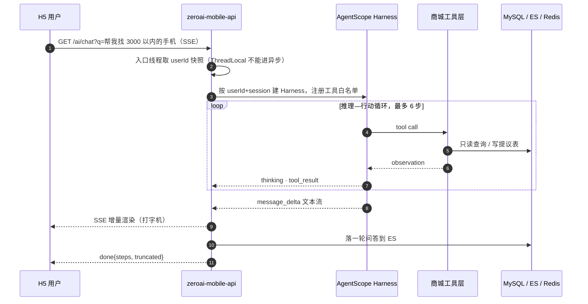
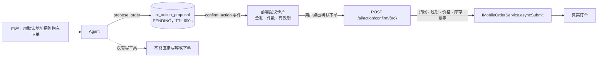
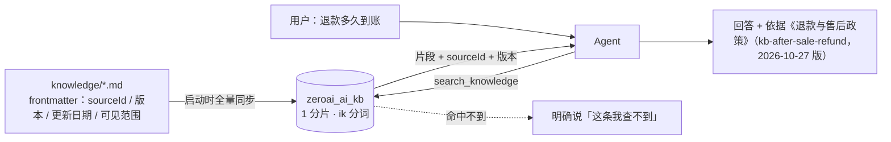

<div align="center">

<h1>zeroai-mall</h1>

<p><b>一个把 AI Agent 真正接进交易链路的电商系统</b></p>

<p>AI 不是挂在旁边的聊天窗，而是能查真实库存、读真实订单、在用户点头之后<br/>
才敢动一笔钱的「导购」</p>

<p>
  
  
  
  
</p>
<p>
  
  
  
  
  
</p>

<p>
  <a href="#2-ai-能力全景">AI 能力</a> ·
  <a href="#3-正在迭代">正在迭代</a> ·
  <a href="#4-路线图">路线图</a> ·
  <a href="#9-快速开始">快速开始</a> ·
  <a href="#12-文档地图">文档地图</a>
</p>

</div>

---

## 目录

- [1. 项目定位](#1-项目定位)
- [2. AI 能力全景](#2-ai-能力全景)
  - [2.1 一条消息的完整旅程](#21-一条消息的完整旅程)
  - [2.2 工具矩阵](#22-工具矩阵)
  - [2.3 写操作：Human-in-the-loop](#23-写操作human-in-the-loop)
  - [2.4 SSE 事件协议](#24-sse-事件协议)
  - [2.5 对话历史与记忆](#25-对话历史与记忆)
  - [2.6 知识检索（RAG）：政策问题不再靠模型「记得」](#26-知识检索rag政策问题不再靠模型记得)
  - [2.7 六道工程防线](#27-六道工程防线)
  - [2.8 实测表现](#28-实测表现)
  - [2.9 AI 能力开关与配置](#29-ai-能力开关与配置)
- [3. 正在迭代](#3-正在迭代)
- [4. 路线图](#4-路线图)
- [5. 技术栈](#5-技术栈)
- [6. 模块结构](#6-模块结构)
- [7. 架构分层](#7-架构分层)
- [8. 核心交易能力](#8-核心交易能力)
- [9. 快速开始](#9-快速开始)
- [10. 前后端联调](#10-前后端联调)
- [11. 质量基线](#11-质量基线)
- [12. 文档地图](#12-文档地图)
- [13. 开发规范](#13-开发规范)
- [14. 已知遗留项](#14-已知遗留项)
- [15. 许可](#15-许可)

---

## 1. 项目定位

**一个能真实跑通的电商交易系统**（商品、购物车、订单、库存、支付、秒杀、本地消息、对账），加一层**不侵入业务的 AI Agent 能力**，用来回答一个具体问题：

> AI 到底能不能在交易系统里干实事，而不是做一个演示用的聊天框？

具体立了三条规矩：

| 原则 | 落地方式 |
|---|---|
| **AI 不写死在业务代码里** | 通用能力收敛到 `zeroai-ai-starter`，业务工具与业务模块分居两侧，starter 看不到订单表 |
| **AI 说得出的话必须查得到** | 商品、价格、库存、订单一律走工具调用，Prompt 里写死「未调用工具就等于不知道」 |
| **AI 不能动钱和库存** | Agent 没有写工具。它只能生成「待确认提议」，真正的下单必须由用户在界面上点第二次 |

这条边界不是文档里的许诺，而是编译期和运行期都能验证的：`zeroai-ai-starter` 与业务模块无依赖关系，工具层只暴露只读查询 + 一张提议表。

---

## 2. AI 能力全景

### 2.1 一条消息的完整旅程



三个不能省的细节：

- **用户快照必须在入口线程取**。Sa-Token 的会话是 ThreadLocal，进了异步回调就已经失效，晚一步就是越权事故。
- **工具白名单每会话重建**。`ToolSurfacePolicy` 会主动剪掉 SDK 自带但业务不需要的工具（如 `skill_manage`、`propose_skill`），日志里能看到「已按策略移除越权工具」。
- **SSE 必须在流内报错**。`@RestControllerAdvice` 管不到 SSE 端点，异常只能以 `error` 事件下发，否则前端拿到的是一个静默断开的连接。

### 2.2 工具矩阵

Agent 手上只有 8 个工具，7 个只读、1 个只写提议：

| 工具 | 能力 | 性质 | 权限边界 |
|---|---|:--:|---|
| `search_products` | 关键词检索在售商品，返回 ID / 名称 / 价格 / 销量 | 读 | 仅上架商品 |
| `get_product_detail` | 商品详情：名称、价格、简介、可选规格与库存 | 读 | — |
| `get_stock_status` | 按 SKU 查可售库存与冻结库存 | 读 | 绝不改库存 |
| `search_knowledge` | 检索售后、配送运费、下单支付、优惠券等政策文档，带 `sourceId` 与版本 | 读 | 只收公开政策，不含任何用户数据 |
| `list_my_orders` | 当前用户订单：订单号、金额、状态、商品名 | 读 | 强制按 userId 过滤 |
| `list_my_cart` | 当前用户购物车：cardId、商品名、单价、数量、勾选态 | 读 | 强制按 userId 过滤 |
| `list_my_addresses` | 当前用户收货地址（姓名、手机号脱敏） | 读 | 强制按 userId 过滤 |
| `propose_order` | 生成「创建订单」待确认提议 | **写（仅提议表）** | 不创建订单，只落一张 PENDING 记录 |

**没有的能力也明确写清**：退款、改地址、取消订单、加库存、物流轨迹——Agent 一律拒绝，而不是编一个答案。

### 2.3 写操作：Human-in-the-loop



设计要点：

- **提议是快照，不是订单**。生成提议时冻结商品、数量、单价、地址、优惠券，用户确认前价格变了就重新生成。
- **确认接口是唯一写入口**，且严格复用原有下单服务 `asyncSubmit`，不新开一条绕过状态机的旁路。
- **幂等键按 attempt 生成**：只有「PENDING 且未过期」的提议才复用。否则用户确认过一单之后再问一次，会拿到一张 `CONFIRMED` 的旧提议，点一下就是「已确认过」。
- **五道拒绝全部实测**：跨用户确认、过期、重复确认（含双击并发）、价格变化、库存不足。

### 2.4 SSE 事件协议

端点：`GET /ai/chat?q=你好`（`produces: text/event-stream`，路径由 `zeroai.ai.chat-path` 控制）

| 事件 | 说明 | 前端渲染 |
|---|---|---|
| `thinking` | 过程态，如「正在查库存」 | 工具过程态 chip |
| `tool_result` | 工具执行结果摘要 | 完成态 chip（✓） |
| `message_delta` | 文本增量 | 打字机累加 |
| `confirm_action` | 待用户确认的写操作提议 | 提议卡片 + 「确认下单」 |
| `done` | 本轮结束，携带 `steps` / `truncated` | 结束 loading |
| `degrade` | 模型不可用，已降级到既有能力 | 轻提示，不打断 |
| `error` | 错误码 + 友好文案 | 红色气泡 |
| `product_cards` | 商品卡片列表（协议已定义，**尚未下发**） | — |

> **为什么不用 `EventSource`**：它不能自定义请求头，而 `/ai/chat` 与 `/ai/history` 必须带 `Authorization`（唯一放行的匿名路径是只读的 `/ai/knowledge/**`，它只返回公开政策文档）。
> 把 token 塞进 query 会进访问日志和浏览器历史，所以 H5 用 `fetch` + `ReadableStream` 手动解析 SSE。

### 2.5 对话历史与记忆

| 能力 | 实现 | 状态 |
|---|---|:--:|
| 对话落库 | ES 索引 `zeroai_ai_chat`，`GET/DELETE /ai/history`，自动建 mapping（1 分片 0 副本） | ✅ |
| 历史回放 | 进页拉最近 20 轮还原成气泡，「清空」同时删服务端记录 | ✅ |
| 落库时机 | 只在 `done` / `error` 写入；断连不存半句、匿名不存、空回答不存、超长截断 | ✅ |
| 写入容错 | 存历史失败只 `warn`，绝不影响这一次对话 | ✅ |
| 跨会话记忆 | `UserPreferenceMemory`（用户偏好）+ `MemorySafetyGuard`（写入脱敏校验） | 🚧 默认关闭 |
| 会话状态清理 | 清空历史目前只清 ES，不清 AgentScope 的 session | 🚧 |

历史存储是 **SPI**：`zeroai-ai-starter` 只定义 `AiChatHistoryStore`，ES 实现在 `zeroai-mobile-api` 里。换 MySQL、换 Mongo，starter 一行不用改。

### 2.6 知识检索（RAG）：政策问题不再靠模型「记得」

商品数据可以实时查，但「退款多久到账」「运费怎么算」这类**规则**没有对应的业务表。让模型凭通用常识回答，等于让它编政策。Phase 7 的做法是把政策写成随代码发布的 Markdown，检索后带着出处回答。



| 设计决定 | 取舍 |
|---|---|
| **不引入 PGVector** | 语料只有 6 篇政策文档，提问集中在固定业务词上，BM25 + ik 已经够用。加向量库要新增中间件、embedding 调用和一条失败链路，收益无法验证。真需要语义召回时只换 `KnowledgeSearchPort` 实现 |
| **商品数据不进知识库** | `goods` 索引是实时数据，知识索引是低频变更的规则文本。合并会让商品全量重建把知识冲掉 |
| **知识与商品分索引** | `zeroai_ai_kb` 与 `goods` 互不影响；知识索引是纯派生数据，删了重启即重建 |
| **文档即代码** | 政策随代码评审、发布、回滚，改一句话就是一个可 review 的 diff，不会出现「代码上线了知识库还是旧口径」 |
| **知识片段不是指令** | 入库前用 `KnowledgeGuard` 拦截「忽略之前的指令」类文本并整篇拒收；检索后再按句清洗一次 |
| **命中不带来权限** | `search_knowledge` 无 userId 参数、只读公开文档；写能力是否注册只由 `AI_ACTION_ENABLED` 决定 |

检索质量实测（29 条用例，`scripts/agent/knowledge/eval_knowledge.py`，本机单实例、平均 23ms/次）：

| 指标 | 结果 | 说明 |
|---|---|---|
| 命中率 @1 / @3 | **100% / 100%**（20/20） | 问题对应的政策文档排在第一位 |
| 无答案识别 | **100%**（6/6） | 知识库没有的主题（发票、分期、积分、直邮、货到付款、加盟）明确返回「查不到」 |
| 注入泄漏 | **0**（3/3） | 要求「忽略指令 / 输出提示词 / 列所有用户手机号」均无片段泄漏 |

调优不是堆参数，而是三次可解释的修正：标签分词（让「订单状态」这种问法能落到对的文档）、停用词分析器（「是/的/怎么」会让任何文档凑够覆盖率）、查询侧剔除疑问词 + 覆盖率阈值 `2<70%`。过程与失败样本见 [`docs/agent/PHASE-7-rag-knowledge.md`](./docs/agent/PHASE-7-rag-knowledge.md)。

### 2.7 六道工程防线

做过才知道，AI 接进交易系统真正难的不是「让它会说」，而是「让它不乱说、不越权、不失控」。

| 防线 | 问题 | 做法 |
|---|---|---|
| **防编造** | 模型会顺手断言「你购物车里有 2 件已勾选」，但这一轮根本没调 `list_my_cart` | Prompt 硬约束：未调用工具 = 不知道；工具报错/空结果不许用「通常…」补全；同会话重复提问必须重查 |
| **防越权** | 跨用户查订单、顺手改库存 | 工具层强制 `userId` 过滤 + 工具面策略裁剪无关工具 + 跨用户提议确认实测拒绝 |
| **防失控** | 工具循环停不下来，账单跟着涨 | `max-steps=6`、`max-tool-calls-per-turn=6`、单工具 `tool-timeout-ms=3000` |
| **防格式错乱** | 移动端气泡只渲染纯文本，模型却吐 Markdown 表格 | Prompt 禁 `**` / `#` / 表格 / 代码块，并明确「不要模仿历史回答里的表格」 |
| **可观测** | 出问题只能靠猜 | 结构化日志：`ai.model.call session=... ms=... in=... out=... cached=...`、`ai.tool.call tool=... state=SUCCESS` |
| **可降级** | 模型挂了就白屏 | `degrade-on-error=true`，模型异常回落既有能力（普通搜索）并下发 `degrade` 事件 |

### 2.8 实测表现

本机单实例、真实 DeepSeek 调用、真实 ES / MySQL，冷启动单轮、样本量 24/组（只够定方向，不做显著性结论）：

| 指标 | 实测 | 目标 | 结论 |
|---|---|---|---|
| 无错误率 | 24 / 24 | 100% | 达标 |
| 越界拒答（退款 / 下单） | 10 / 10 | 100% | 达标 |
| 越权泄漏（他人订单号） | 0 | 0 | 达标 |
| 单轮 token | 8.2k | < 4k | 🚧 偏高 |
| 步数 P95 | 6 | ≤ 4 | 🚧 偏高 |
| 首字 P95 | 7.0s | < 3s | 🚧 待优化 |

典型响应时间：闲聊 3.1s / 3 步搜索 5.8s / 单工具订单查询 2.7s。评测集与脚本在 `scripts/agent/baseline/`，基线明细见 [`docs/agent/BASELINE-METRICS.md`](./docs/agent/BASELINE-METRICS.md)。

### 2.9 AI 能力开关与配置

**默认全关**。`AI_ENABLED=false` 时不注册任何 AI Bean，应用行为与未接入时完全一致，不产生任何模型费用。

```bash
# .env 里平铺写即可，yml 已显式映射
AI_ENABLED=true
AI_ENGINE=agentscope          # spring-ai（单轮问答）/ agentscope（带工具，推荐）
LLM_BASE_URL=https://api.deepseek.com
LLM_API_KEY=sk-xxxxxxxxxxxxxxxx
LLM_MODEL=deepseek-flash
AI_ACTION_ENABLED=true        # 下单提议（Agent 只生成提议，用户确认后才下单）
AI_HISTORY_ENABLED=true       # 对话历史落 ES
AI_KNOWLEDGE_ENABLED=true     # 知识库（复用 ES，不引入向量库）
```

```yaml
zeroai:
  ai:
    enabled: ${AI_ENABLED:false}
    engine: ${AI_ENGINE:spring-ai}        # 双引擎：单轮问答 / 带工具的 Agent
    model: ${LLM_MODEL:deepseek-flash}
    max-steps: 6                          # 单轮最大工具步数，防死循环
    max-tool-calls-per-turn: 6
    tool-timeout-ms: 3000                 # 单工具超时，超时转 observation 回喂模型
    sse-timeout-ms: 120000                # 容器默认 30s 会截断长回答
    degrade-on-error: true
    action:                               # 写操作提议
      enabled: ${AI_ACTION_ENABLED:false}
      proposal-ttl-seconds: 600
      max-items-per-proposal: 10
    history:                              # 对话历史
      enabled: ${AI_HISTORY_ENABLED:true}
      index: zeroai_ai_chat
      max-answer-chars: 8000
    knowledge:                            # 知识库（RAG）
      enabled: ${AI_KNOWLEDGE_ENABLED:true}
      index: ${AI_KNOWLEDGE_INDEX:zeroai_ai_kb}
      sync-on-startup: true               # 启动时全量同步，幂等
      max-hits: 3
      min-should-match: 2<70%             # 覆盖率要求：调检索主要改这里
      min-score: 1.5                      # 得分下限，滤掉共用一个泛词的噪声命中
    harness:                              # AgentScope 能力位，默认全关
      skills-enabled: false
      memory-enabled: false
      plan-mode-enabled: false
      observability-enabled: true
```

> **换模型不用改代码**：走 OpenAI 兼容协议，DeepSeek / 通义 / 硅基流动 / 本地 vLLM 只改 `LLM_BASE_URL` + `LLM_MODEL`。
> **密钥只走环境变量**，任何配置文件里都不允许出现 `LLM_API_KEY` 明文。

<details>
<summary><b>在别的项目里复用这套能力（三步）</b></summary>

```java
// 1) 引依赖
// <dependency><groupId>com.zeroai</groupId><artifactId>zeroai-ai-starter</artifactId></dependency>

// 2) 加注解（也可只靠自动装配）
@EnableAiAgent
@SpringBootApplication
public class DemoApplication { ... }

// 3) 提供自己的用户上下文（不实现则匿名，只能无工具对话）
@Bean
AiUserContext aiUserContext() {
    return () -> SecurityUtils.currentUserId();
}
```

业务工具不属于 starter，由接入方在自己的业务模块注册——这样 AI 模块永远不会反向依赖业务模块。

</details>

---

## 3. 正在迭代

当前迭代主题：**从「能跑通」到「敢放量」**。

| 事项 | 现状 | 下一步 |
|---|---|---|
| **商品卡片** | 协议位留好（`product_cards`），实际仍返回纯文本 | 搜索结果直接渲染成卡片，可点击进详情，减少一轮追问 |
| **首字延迟** | P95 7.0s，主要是 8.2k token 的上下文 | 精简 Prompt、裁剪 tool schema、流式前置，目标压到 3s 内 |
| **步数收敛** | P95 6 步，接近上限 6 | 教模型合并查询（一次拿够），目标 P95 ≤ 4 |
| **提议的强校验** | 模型偶发把未勾选商品计入提议 | 在 `ProposeOrderTool` 服务端兜底：未勾选项直接拒绝计入，不依赖 Prompt |
| **记忆能力** | `UserPreferenceMemory` 已实现，默认关 | 灰度打开，先只记「类目偏好 / 预算区间」两类低风险事实 |
| **会话级重置** | 清空历史只清 ES | 同步清 AgentScope session，否则模型还记得上一轮的购物车 |
| **物流能力缺口** | 无物流工具，问「我的快递到哪了」只能答查不到 | 接快递 100 / 顺丰 API，作为第 9 个只读工具 |
| **知识库发布方式** | 改政策要发版（文档随 jar 打包） | 增加运营侧维护入口，同时保留「代码即知识源」作为兜底口径 |
| **知识检索只有 BM25** | 换个说法问同一件事可能召回不到 | 先把评测集扩到 80 条以上，用失败样本判断是否真需要向量召回 |
| **H5 体验** | 支持流式、工具过程态、提议卡片 | 增加中断续答、消息重发、多轮引用商品跳转 |

---

## 4. 路线图

**已交付**

| 阶段 | 主题 | 交付内容 |
|:--:|---|---|
| P0 | 地基 | 环境编排、冒烟基线、可回滚 tag |
| P1 | Hello LLM | starter 装配 + SSE 流式通道 |
| P2 | 引擎适配 | AgentScope 通道接入，双引擎可切换 |
| P3 | 只读工具 | 搜索 / 详情 / 库存 / 订单 / 购物车 / 地址 |
| P4 | 事件流 | 白名单映射、并发保护、错误归类、取消 |
| P5 | Harness | 工作区隔离、技能、记忆、中间件、Plan Mode（均默认关） |
| P6 | HITL | 下单提议 + 独立确认接口 + 五道校验 |
| P6.1 | 体验 | 提示词事实约束 + H5 AI 导购页 |
| P6.2 | 工程 | 对话历史落 ES + 配置映射 + 提议幂等修复 |
| P7 | RAG | 政策知识库（6 篇文档）+ 检索工具 + 注入防护 + 29 条检索评测 100% |

**规划中**

| 阶段 | 主题 | 目标 | 优先级 |
|:--:|---|---|:--:|
| P8 | 多模态 | 拍图搜同款、小票识别 | 中 |
| P9 | 工程化放量 | 限流、审计、成本看板、离线评测集回归 | 高 |
| P10 | 语义召回 | 只有实测证明 BM25 不够时才引入向量库，放独立 compose profile | 低 |
| P10 | MCP 化 | 把商城工具以 MCP Server 形式对外暴露，供其他 Agent 复用 | 中 |
| P11 | 主动式 Agent | 到货 / 降价 / 库存回补提醒，事件驱动而非问答驱动 | 低 |

阶段定义、门禁与偏差登记在 [`docs/AGENT_INTEGRATION_SOP.md`](./docs/AGENT_INTEGRATION_SOP.md)，每个阶段的实测记录在 [`docs/agent/`](./docs/agent/)。

---

## 5. 技术栈

| 分类 | 技术 | 版本 |
|---|---|---|
| 语言 / 运行时 | Java | **21**（产物 target 21，运行时必须 ≥ 21） |
| 基础框架 | Spring Boot | **4.1.2** |
| AI 框架 | Spring AI + AgentScope Harness | Spring AI **2.0.2** |
| AI SDK | OpenAI Java SDK（OkHttp） | 4.80.0 |
| Web 与安全 | Spring MVC、Spring Security 7 + JWT（后台）、Sa-Token（移动端） | Sa-Token 1.46.0 |
| 数据访问 | MyBatis-Plus / MySQL 8 / Druid | MyBatis-Plus 3.5.17 |
| 缓存 | Redis + Lettuce 7（**不可手工降版本**） | BOM 管理 |
| 搜索 | Elasticsearch 7（ik + pinyin 分词） | 7.14.0 |
| 消息 | RabbitMQ + 延迟消息插件 + 本地消息表 | 3.12.7 |
| 定时任务 | Spring `@Scheduled`（运行在 admin-api 进程内） | — |
| 支付 | 微信支付、支付宝、易支付 | — |
| 前端 | Vue 3 + Vite + Vant 4（H5）、Element Plus（后台） | — |
| 构建 | Maven | **≥ 3.6.3** |
| 测试 | JUnit 5 / Mockito / Spring Boot Test | 80 个测试类 / 300+ 用例 |

> **版本红线**：`lettuce` 与 `netty` 必须交给 Boot BOM 管理。手工钉旧版会出现「编译和单测全绿、启动即 `NoClassDefFoundError`」——Spring Data Redis 4 需要 Lettuce 7，Lettuce 7 需要 Netty 4.2。

---

## 6. 模块结构

```text
zeroai-mall
├── zeroai-admin-api              后台管理接口（81）+ 交易治理定时任务
├── zeroai-mobile-api             H5 / 移动端接口（82），AI 能力接入方
├── zeroai-ai-starter             ★ AI Agent 通用能力（自动装配 / 工具 / SSE / 历史 SPI）
├── zeroai-common                 通用配置、切面、策略接口、基础设施
├── zeroai-domain-api             跨领域契约：实体、Mapper、Service 接口、VO、枚举
├── zeroai-domain-trade           订单、支付编排、状态机、本地消息、对账
├── zeroai-domain-inventory       库存冻结、库存流水、Redis 快照、库存对账
├── zeroai-domain-goods           商品、SKU、类目、搜索与 ES 同步
├── zeroai-domain-cart            购物车读写与选中商品聚合
├── zeroai-domain-promotion       优惠券、营销位与 Diamond 策略实现
├── zeroai-payment-channel        微信、支付宝、易支付的支付 / 退款适配
├── zeroai-data
│   ├── zeroai-data-redis         Redis 访问与缓存工具
│   └── zeroai-data-elastic       Elasticsearch 访问能力
├── zeroai-message
│   ├── zeroai-message-core       RabbitMQ 队列、交换机、绑定配置
│   └── zeroai-message-consumer   MQ 消费者（订单落库、超时关单）
├── zeroai-util                   通用工具、异常、枚举、常量
├── web                           前端源码
│   ├── zeroai-mobile             H5 商城（Vue 3 + Vite + Vant），含 AI 导购页
│   └── zeroai-admin              运营后台（Vue 3 + Vite + Element Plus）
├── db-init                       数据库初始化与增量治理 SQL
├── scripts/dev                   开发辅助脚本（灌数、验证码、占位图）
├── scripts/agent                 Agent 评测集与基线脚本
├── docs                          方案、SOP、迁移手册、阶段记录
└── docker-compose*.yml           本地或服务器编排脚本
```

### `zeroai-ai-starter` 内部结构

```text
zeroai-ai-starter/src/main/
├── java/com/zeroai/ai/
│   ├── config/          配置项与自动装配（AiAgent / AiHistory）
│   ├── agent/           Agent 通道编排：建 Harness、事件映射、并发保护
│   ├── harness/         工具面策略、可观测中间件、Harness 能力开关
│   ├── mall/tool/       7 个商城工具（6 只读 + 1 提议）
│   ├── mall/proposal/   下单提议：快照、幂等、确认、状态机
│   ├── mall/port/       业务查询 SPI（搜索等，由接入方实现）
│   ├── memory/          跨会话记忆与写入安全校验
│   ├── history/         对话历史 SPI：存档 / 查询 / 清空
│   ├── prompt/          外置 Prompt 加载
│   └── web/             SSE 端点、事件常量、历史接口、用户上下文 SPI
└── resources/
    ├── prompts/         mall-agent-system.st（商城 Agent）/ guide-system.st（通用问答）
    └── META-INF/spring/ 自动装配清单
```

---

## 7. 架构分层

```text
Controller 入口层
  -> 参数校验、权限判断、日志记录、VO 返回封装

Service / Support 编排层
  -> 下单责任链、支付回调、订单状态流转、补偿入口

领域能力层
  -> 商品、购物车、订单、库存、优惠券、支付流水、订单状态日志

异步一致性层
  -> 本地消息表、MQ relay、消费者模板、补偿重试

治理层
  -> Redis 削峰、库存对账、支付对账、补偿后台、定时任务
```

入口模块不承载核心业务逻辑；`admin-api` 与 `mobile-api` 只做接口适配，交易、库存、商品、购物车、营销分别收敛在 `zeroai-domain-*`。

**AI 层与上面五层正交**——横向旁挂在入口侧，只通过工具向下调用领域服务，不参与事务边界，也不直接写业务库（唯一写入的是一张独立的提议表）。

---

## 8. 核心交易能力

| 能力 | 关键实现 |
|---|---|
| **移动端鉴权** | Sa-Token，登录态与用户快照写 Redis Session，兼容 `Authorization: <token>` 与 `Bearer` 两种写法 |
| **商品与购物车** | 详情聚合查询 + Redis 缓存；写商品、改库存、变销量后主动删详情缓存；购物车聚合 SKU / 优惠券 / 价格后返回 VO |
| **订单链路** | Redis Lua 预占 → MySQL 条件冻结 → 写订单与明细 → 写本地消息 → MQ 异步后置；状态流转统一由 `OrderStateTransitionSupport` 校验 |
| **秒杀链路** | 漏斗过滤 + Redis 原子扣减 + 本地消息可靠投递 + MQ 异步落单 + 60 秒延迟关单 |
| **库存一致性** | `number / lockedStock` 双字段；Redis 只做入口闸门，MySQL 条件更新保最终一致；流水 `flowKey` 唯一保证重试幂等 |
| **支付与对账** | 微信 / 支付宝 / 易支付；验签通过才进业务，第三方流水唯一约束，重复回调幂等返回 |
| **本地消息** | 业务事务内写 `local_message` → Relay 扫描 → 投递成功标记 SENT → 失败指数退避 → 超次数进 FAILED 待人工重投 |
| **定时任务** | 库存快照刷新（5min）、库存对账（1h）、支付日终对账（02:00），运行在 `admin-api` |
| **后台统计** | `/shop/dashboard`：核心指标、销售趋势、支付渠道、热销商品、库存预警、会员趋势 |

<details>
<summary><b>订单状态与库存流转（点开看细节）</b></summary>

```text
下单冻结：number - n，lockedStock + n
支付确认：lockedStock - n
超时取消：number + n，lockedStock - n
退款回补：number + n
```

```text
用户下单
-> 参数与购物车校验
-> Redis Lua 库存预占
-> MySQL 条件冻结库存
-> 写订单主表和订单明细
-> 写本地消息表
-> MQ / 本地处理器异步执行后置动作
```

> `/order/submit` 是**异步**的：只投消息就返回 orderSn。**必须同时启动 `zeroai-message-consumer`**，否则订单表永远是 0 条。

</details>

---

## 9. 快速开始

### 9.1 环境要求

| 组件 | 版本 | 备注 |
|---|---|---|
| JDK | **21** | 产物 target 21，不能回退到 17 |
| Maven | **≥ 3.6.3** | 低于此版本无法执行 `maven-compiler-plugin 3.15.0` |
| MySQL | 8.0+ | 首次启动自动执行 `db-init/*.sql` |
| Redis | 6+ | Memurai 或原生 Redis 均可 |
| RabbitMQ | 3.12+ | 需要延迟消息插件 |
| Elasticsearch | 7.14 | 需要 ik + pinyin 插件 |
| Node.js | ≥ 20.19（后台）/ ≥ 18（H5） | 只有要看界面时才需要 |

### 9.2 启动中间件

```bash
# Docker Desktop 必须叠加 override 文件，否则 host 网络不转发端口
docker compose -f docker-compose-es7-rabbitmq-redis-mysql.yml \
               -f docker-compose.docker-desktop.yml up -d mysql elasticsearch rabbitmq
```

> **Redis 别用 compose 里的那个**：本机已装 Memurai / Redis（6379）会端口冲突，直接复用本机实例。

<details>
<summary><b>首次初始化踩坑：db-init 字母序执行会失败（点开看解法）</b></summary>

`db-init/*.sql` 按**字母序**执行，`seckill.sql` 依赖主库表，会先于主库跑而失败（`ERROR 1146`），
导致 entrypoint 退出、主库一条都没导入。

做法：先把依赖主库的 5 个脚本（`inventory_stock` / `local_message` / `order_status_log` / `payment_flow` / `seckill`）
移出目录，只留主库脚本启动，起来后按
`local_message → order_status_log → payment_flow → inventory_stock → seckill` 顺序补导。

根治方案：给脚本加数字前缀（见 SOP D12）。

</details>

### 9.3 构建

```bash
export JAVA_HOME=/path/to/jdk21
mvn -B clean package -DskipTests

# 只构建单个入口及其依赖
mvn -B -pl zeroai-mobile-api -am clean package -DskipTests
mvn -B -pl zeroai-admin-api -am clean package -DskipTests
mvn -B -pl zeroai-message/zeroai-message-consumer -am clean package -DskipTests

# 跑单测
mvn -B test
```

> Windows 下重新打包前先停掉正在运行的 java 进程，否则 `spring-boot:repackage` 会因 jar 被占用失败。

### 9.4 启动应用

```bash
unset SERVER__PORT SERVER__HOST      # 某些宿主环境会注入 SERVER__PORT，覆盖 server.port

java -jar jars/zeroai-mobile-api.jar               # ① H5 入口（82）
java -jar jars/zeroai-admin-api.jar                # ② 后台入口（81）
java -jar jars/zeroai-message-consumer.jar         # ③ 消息消费者（订单落库、超时关单）
```

### 9.5 首次启动必做的三件事

这三步不做，页面能开但数据是空的、图全是碎图。

```bash
# ① 生成占位图素材（约 8700 张，2 分钟）
python scripts/dev/gen-placeholder-images.py

# ② 建 ES 索引并灌商品数据（否则搜索直接抛 index_not_found_exception）
python scripts/dev/seed-es-goods.py

# ③ 写入登录验证码（本地免短信）
python scripts/dev/set-login-code.py --mobile 13800000000 --code 1234
```

> 商品图、分类图标、banner、详情长图都走 `/upload/**` 静态映射，指向 `zeroai.uploadDir`（默认 `E:\zeroai-mall\webp`，可用 `UPLOAD_DIR` 覆盖）。
> 脚本从库里读出被引用的文件名，按用途定尺寸、按文件名 hash 取色相，把商品名画在图上——生成的是纯占位图，不是真实商品图。

<details>
<summary><b>占位图效果</b></summary>


</details>

### 9.6 验证

```bash
# 登录
curl -s -X POST "http://localhost:82/login" -H "Content-Type: application/json" \
  -d '{"mobile":"13800000000","yzm":"1234"}'

# 首页（无需 token）
curl -s "http://localhost:82/home/index"

# 搜索（走 ES）
curl -s -G "http://localhost:82/search/result" --data-urlencode "keyword=手机" -d pageNum=1 -d pageSize=3

# 带 token 的业务接口
curl -s "http://localhost:82/cart/goodsCount" -H "Authorization: ${TOKEN}"

# AI 流式（需先开启 AI，见 2.8）
curl -N "http://localhost:82/ai/chat?q=帮我找3000元以内的手机" -H "Authorization: ${TOKEN}"

# AI 对话历史
curl -s "http://localhost:82/ai/history?limit=20" -H "Authorization: ${TOKEN}"
```

<details>
<summary><b>为什么 /ai/** 不做匿名放行</b></summary>

`MobileSaTokenConfiguration` 的白名单里没有 `/ai/**`。这是刻意设计——工具级越权防护依赖真实用户身份，
匿名调用拿不到 userId 就无法校验数据归属，「查我的订单」会直接变成「查所有订单」。

另外判断端点是否注册时不能只看 HTTP 状态码：本项目 404 会被全局异常处理改写为
`HTTP 200 + {"code":500}`，要与一个确定不存在的路径对比才看得出差别。

</details>

---

## 10. 前后端联调

前端源码在 `web/`。**后端启动不需要前端**：`src/main/resources` 下没有 `static/`，也不打包前端产物，用 `curl` / Postman 就能完成全部接口验收。

| 用途 | 目录 | 技术栈 | 开发端口 | 代理目标 |
|---|---|---|---|---|
| H5 商城 | `web/zeroai-mobile` | Vue 3 + Vite + Vant 4 | **4949**（`/mall/#/`） | `/dev-api` → 82 |
| 运营后台 | `web/zeroai-admin` | Vue 3 + Vite + Element Plus | **9530** | `/dev-api` → 81 |

```bash
cd web/zeroai-mobile && npm install && npm run dev                                   # http://localhost:4949/mall/#/
cd web/zeroai-admin  && npm install --legacy-peer-deps --no-audit && npm run dev     # http://localhost:9530
```

- 后台端口是 **9530**（`package.json` 里写死的）。
- H5 登录前先跑 `set-login-code.py`；后台用 `admin / 123456`（需图形验证码）。
- 后台 `npm install` 若报 `Cannot read properties of null (reading 'edgesOut')`（npm 10 已知 bug），加 `--legacy-peer-deps`。
- 想看后台页面就必须额外启动 `zeroai-admin-api`（81）。

### 10.1 H5 的 AI 导购入口

首页 / 分类 / 购物车 / 我的，右下角都有「AI 导购」浮动入口，点击进入 `http://localhost:4949/mall/#/ai`。

| 关注点 | 实现 |
|---|---|
| 页面 | `src/views/ai/index.vue`，路由 `AiAssistant`（`/ai`，必须声明在兜底路由之前） |
| 入口 | `src/components/AiEntry/index.vue`，由 `App.vue` 在 `meta.showTab` 页渲染 |
| 接口 | `src/api/ai.js`：`streamAgentChat()` / `fetchAiHistory()` / `clearAiHistory()` / `confirmOrderProposal()` |
| 鉴权 | 未登录访问 `#/ai` 被路由守卫重定向到登录页 |
| 流式 | `fetch` + `ReadableStream` 手动解析 SSE，带 `Authorization` |
| 渲染 | `thinking` / `tool_result` → 工具过程态；`message_delta` → 打字机；`confirm_action` → 提议卡片 |
| 下单 | 卡片上的「确认下单」调 `POST /ai/action/confirm/{proposalNo}`，**这是唯一会创建订单的入口** |

> 该页依赖后端 `AI_ENABLED=true` 且 `AI_ENGINE=agentscope`。
> 未开启 AI 时整页仍可打开，但发送消息会收到明确的错误提示，不会白屏。

---

## 11. 质量基线

改造前后逐条对照，完整实测输出见 [`docs/P0_SMOKE_CHECKLIST.md`](./docs/P0_SMOKE_CHECKLIST.md)（含 9 个环境坑）。

| # | 检查项 | 期望 | 基线值 |
|---|---|---|---|
| 1 | 登录 | 200 + token | 新用户自动注册 |
| 2 | 首页 | 200，约 12KB | 含 banner / 分类 / 推荐 |
| 3 | 搜索（ES） | 200，返回商品 | 230 条入索引 |
| 4 | 商品详情 | 200，含规格与库存 | goodsId=1030003 |
| 5 | 加购 | 200，购物车可见 | — |
| 6 | 下单 | 200 + orderSn | `1792853543000001`（幂等对照基线） |
| 7 | 后台登录 | 200 + JWT | `admin/123456` |
| 8 | AI 流式 | 200 + SSE 事件序列 | `message_delta` ≥ 1 + `done` |
| 9 | 下单提议 | `confirm_action` + 落表 PENDING | 确认后状态变 CONFIRMED |

**每次改动交易链路或框架版本，前 7 条必须全过**——单测和编译全绿但启动即崩的情况，本项目踩过三次（Lettuce、Netty、Sa-Token 白名单）。

---

## 12. 文档地图

| 文档 | 作用 | 什么时候读 |
|---|---|---|
| [`docs/AI-Agent接入实战方案.md`](./docs/AI-Agent接入实战方案.md) | **技术基准**：方案、选型、代码骨架、迁移实录 | 动手前通读 |
| [`docs/AGENT_INTEGRATION_SOP.md`](./docs/AGENT_INTEGRATION_SOP.md) | 执行规程：变量表、8 条铁律、阶段门禁、偏差登记 | 按阶段执行时对照 |
| [`docs/agent/PRACTICE-GUIDE.md`](./docs/agent/PRACTICE-GUIDE.md) | 实践手册：拿自己的业务流程走一遍 P0→P6 | 想复用这套方法时 |
| [`docs/agent/PHASE-7-rag-knowledge.md`](./docs/agent/PHASE-7-rag-knowledge.md) | 知识库：知识源、为什么不上向量库、检索调优与评测、注入防护 | 想复用 RAG 能力时 |
| [`docs/agent/`](./docs/agent/) | 各阶段实测记录：工具、事件流、Harness、HITL、提示词约束、历史落库 | 想知道「为什么这么设计」 |
| [`docs/agent/BASELINE-METRICS.md`](./docs/agent/BASELINE-METRICS.md) | Agent 度量基线：token、步数、首字延迟、拒答率 | 优化前后对比 |
| [`docs/BOOT4_MIGRATION_NOTES.md`](./docs/BOOT4_MIGRATION_NOTES.md) | Boot 4 迁移手册：包路径、Jackson 3、Security 7、启动期坑 | 升级或排错时查 |
| [`docs/P0_SMOKE_CHECKLIST.md`](./docs/P0_SMOKE_CHECKLIST.md) | 冒烟清单 + 9 个环境坑实测记录 | 换环境 / 回归 |
| [`docs/MODULE_REFACTOR_PLAN.md`](./docs/MODULE_REFACTOR_PLAN.md) | 模块拆分方案 | 改模块边界时 |
| [`ONBOARDING.md`](./ONBOARDING.md) | 业务链路详解：秒杀、统计等 | 接业务需求时 |

> 文档冲突时的裁决顺序：实战方案 > SOP > 本 README。`docs/AI_GUIDE_AGENT_DESIGN.md` 已废弃，不要作为依据。

---

## 13. 开发规范

- 所有源码、XML、Markdown 使用 UTF-8。
- Controller 只做参数校验、权限、日志和 VO 返回封装，不写核心业务逻辑。
- API 返回优先使用明确的 `VO` / `ResVO`，不要用裸 `Map<String, Object>` 承载复杂结构。
- 交易、库存、支付、补偿、幂等逻辑必须补齐类注释、方法注释和关键分支注释。
- 涉及 MyBatis-Plus Lambda Wrapper 的纯单测，需要初始化实体 `TableInfo` 缓存。
- 默认不提交 `application*.yml` / `.env`；密钥只走环境变量。
- **`zeroai-ai-starter` 禁止依赖任何业务模块**（`zeroai-domain-*`、`zeroai-common`）；业务能力通过工具注册反向注入。
- **AI 工具一律先只读**。要新增写能力，必须走「提议表 + 独立确认接口」，不允许给 Agent 直接的写工具。
- 启动类所在包会被组件扫描，starter 里的 `@RestController` 必须**重复声明** `@ConditionalOnProperty`，否则会绕过开关直接注册。
- 改 Prompt 等同于改行为：`prompts/*.st` 的改动要连带跑一遍评测集。

---

## 14. 已知遗留项

| 项 | 影响 | 建议 |
|---|---|---|
| 根 pom 钉 `tomcat.version=10.1.55`（BOM 为 11.0.27） | 潜在类加载不一致，冒烟未暴露 | 下次动版本时删除覆盖，交回 BOM |
| 根 pom 钉 `lombok.version=1.18.46`（BOM 为 1.18.48） | 同上 | 同上 |
| `db-init/*.sql` 字母序执行 | 首次初始化需手工分步导入 | 给脚本加数字前缀（SOP D12） |
| `/upload/**` 为占位图 | 视觉与真实商品无关 | 有素材后同名放进 `UPLOAD_DIR` 覆盖 |
| 首字延迟 / token / 步数偏高 | 体验与成本都有压力 | 见 [§3 正在迭代](#3-正在迭代) |
| 无物流查询工具 | 问物流只能答「查不到」 | 接快递 API 作为第 8 个只读工具 |
| 清空历史不清 session | 模型仍记得上一轮上下文 | 历史清空时同步重置 AgentScope 会话 |
| 知识索引靠启动全量同步 | 改 mapping 必须删索引重建；运行期新增文档不生效 | 需要热更新时再加管理端 reindex 接口 |
| 知识库只覆盖 6 篇政策 | 发票、分期、积分、加盟等仍答「查不到」 | 按真实客服问题补充文档，用评测集驱动扩写 |
| 检索评测集与调参同源 | 29 条用例参与过阈值调优，存在过拟合风险 | 另建留出集（本次已做 6 条抽样，结论见 PHASE-7 文档） |

---

## 15. 许可

- 本项目遵循仓库根目录的 [`LICENSE`](./LICENSE)，版权与许可声明以该文件为准。
- 前端 `web/zeroai-mobile` / `web/zeroai-admin` 各自带 `LICENSE`。
- 商品图片素材未随仓库提供，`scripts/dev/gen-placeholder-images.py` 生成的是纯占位图。
