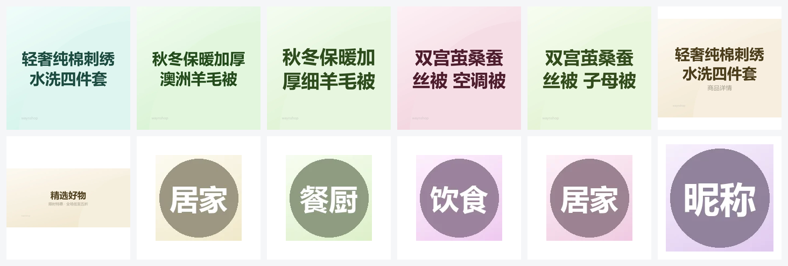

# zeroai-mall · AI Agent 二开版

> 一个覆盖完整交易主干（商品、购物车、订单、库存、支付、秒杀、本地消息、对账）的电商商城后端，在此基础上做两件事：
> **① 全栈升级到 Spring Boot 4.1.2 + JDK 21**；
> **② 抽出可复用的 AI Agent 能力层 `zeroai-ai-starter`，把 AI 接进真实交易链路，而不是做一个游离在业务之外的聊天 demo。**

技术基准文档见 [`docs/AI-Agent接入实战方案.md`](./docs/AI-Agent接入实战方案.md)，执行规程见 [`docs/AGENT_INTEGRATION_SOP.md`](./docs/AGENT_INTEGRATION_SOP.md)。

---

## 目录

- [1. 项目定位](#1-项目定位)
- [2. 版本与演进](#2-版本与演进)
- [3. 技术栈](#3-技术栈)
- [4. 模块结构](#4-模块结构)
- [5. AI Agent 能力](#5-ai-agent-能力)
- [6. 架构分层](#6-架构分层)
- [7. 核心业务能力](#7-核心业务能力)
- [8. 快速开始](#8-快速开始)
- [9. 前后端联调](#9-前后端联调)
- [10. 冒烟基线](#10-冒烟基线)
- [11. 文档地图](#11-文档地图)
- [12. 开发规范](#12-开发规范)
- [13. 已知遗留项](#13-已知遗留项)
- [14. 许可与致谢](#14-许可与致谢)

---

## 1. 项目定位

**一句话**：一个真实可跑通的电商后端，加一层「不侵入业务」的 AI Agent 能力，用来验证 **AI 到底能不能在交易系统里干实事**。

具体验证三件事：

| 目标 | 落地方式 |
|---|---|
| AI 不写死在业务代码里 | 通用能力全部收敛到 `zeroai-ai-starter`，业务模块只在启动类加一个注解 |
| AI 说得出的话必须查得到 | 商品、库存、价格一律走工具调用（Tool Calling），禁止模型凭空生成 |
| AI 不能动钱和库存 | 写操作（加购、下单）只输出「提议」，必须由用户在界面上确认后才执行（Human-in-the-loop） |

**边界**：`zeroai-ai-starter` 只依赖 Spring / Spring AI，**零业务依赖**；业务工具后续放在独立的 `zeroai-ai-mall` 模块，只依赖 `zeroai-domain-api`，编译期看不到任何写入口。

## 2. 版本与演进

| 项 | 当前状态 |
|---|---|
| 版本号 | **2.0.0**（`pom.xml`） |
| 基线 tag | `p0-base`（Agent 改造前的最后一个可运行状态） |
| 基础框架 | **Spring Boot 4.1.2 / Java 21** |
| AI 能力 | **Spring AI 2.0.2 + `zeroai-ai-starter`** |
| 前端 | 已放到 `web/`（独立仓库，非本仓库子模块） |

### 2.1 本版主要改造内容

| 类别 | 改动 | 说明 |
|---|---|---|
| 框架 | Boot 3.5.14 → **4.1.2** | 强制要求 JDK 21；Spring AI 2.x 的编译基线 |
| 框架 | Spring AI 1.1.8 → **2.0.2** | `OpenAiApi` 已移除，改用官方 SDK `OpenAIOkHttpClient` 构建 `ChatModel` |
| 框架 | Jackson 2 → **Jackson 3** | 包名 `tools.jackson.*`，异常体系改为 `JacksonException` |
| 框架 | Spring Security 6 → **7** | `UserDetails#getAuthorities()` 返回 `null` 会直接 NPE（已修） |
| 框架 | Sa-Token 1.46 | 登录会话对象必须登记 JSON 白名单（`SaJsonType`） |
| 新增模块 | **`zeroai-ai-starter`** | 自动装配 + 外置 Prompt + SSE 通道，默认关闭 |
| 新增脚本 | `scripts/dev/gen-placeholder-images.py` | 生成 `/upload/**` 占位图（仓库不含图片素材） |
| 新增脚本 | `scripts/dev/seed-es-goods.py` | 一键建 ES 索引并灌入商品数据 |
| 新增脚本 | `scripts/dev/set-login-code.py` | 本地免短信登录（写验证码到 Redis） |
| 修复 | `LoginUserDetail#getAuthorities()` | Security 7 下后台登录必失败的真实 bug |
| 修复 | `docker-compose` ES 密码 | 列表写法把引号写进了密码值，导致 ES 401 |
| 编排 | `docker-compose.docker-desktop.yml` | Docker Desktop 下 `network_mode: host` 不转发端口 |
| 文档 | `docs/` 全套 | 迁移手册、接入 SOP、冒烟清单 |

### 2.2 版本演进策略

项目已经做过**结构性升级**（Boot 4 + JDK 21 + Jackson 3），主线只往前走：

- **框架升级** → 不再回退，只往前走（Boot 4.x → 4.y）。
- 每次升级前先打 tag，升级后对照 `docs/BOOT4_MIGRATION_NOTES.md` 检查是否有新的包路径搬迁。
- 早期基线只作历史参考，不再跟进。

## 3. 技术栈

| 分类 | 技术 | 版本 |
|---|---|---|
| 语言 / 运行时 | Java | **21**（产物 target 21，运行时必须 ≥ 21） |
| 基础框架 | Spring Boot | **4.1.2** |
| AI 框架 | Spring AI | **2.0.2** |
| AI SDK | OpenAI Java SDK（OkHttp 实现） | 4.80.0 |
| Web 与安全 | Spring MVC、Spring Security 7 + JWT（后台）、Sa-Token（移动端） | Sa-Token 1.46.0 |
| 数据访问 | MyBatis-Plus / MySQL 8 / Druid | MyBatis-Plus 3.5.17 |
| 缓存 | Redis + Lettuce 7（**不可手工降版本**） | BOM 管理 |
| 搜索 | Elasticsearch 7（ik + pinyin 分词） | 7.14.0 |
| 消息 | RabbitMQ + 延迟消息插件 + 本地消息表 | 3.12.7 |
| 定时任务 | Spring `@Scheduled`（运行在 admin-api 进程内） | — |
| 支付 | 微信支付、支付宝、易支付 | — |
| 构建 | Maven | **≥ 3.6.3**（`maven-compiler-plugin 3.15.0` 的要求） |
| 测试 | JUnit 5 / Mockito / Spring Boot Test | — |

> **版本红线**：`lettuce` 与 `netty` 的版本**必须**交给 Boot BOM 管理。手工钉旧版会出现「编译和单测全绿、启动即 `NoClassDefFoundError`」——Spring Data Redis 4 需要 Lettuce 7，Lettuce 7 需要 Netty 4.2。

## 4. 模块结构

```text
zeroai-mall
├── zeroai-admin-api              后台管理接口（81）+ 交易治理定时任务
├── zeroai-mobile-api             H5 / 移动端接口（82），依赖 ai-starter
├── zeroai-ai-starter             ★ AI Agent 通用能力（自动装配 / 外置 Prompt / SSE 通道）
├── zeroai-common                 通用配置、切面、策略接口、通用模型和基础设施
├── zeroai-domain-api             跨领域契约：实体、Mapper、Service 接口、VO、枚举
├── zeroai-domain-trade           订单、支付编排、状态机、本地消息、对账
├── zeroai-domain-inventory       库存冻结、库存流水、Redis 库存快照、库存对账
├── zeroai-domain-goods           商品、SKU、类目、搜索与 ES 同步
├── zeroai-domain-cart            购物车读写与选中商品聚合
├── zeroai-domain-promotion       优惠券、营销位和 Diamond 策略实现
├── zeroai-payment-channel        微信、支付宝、易支付的支付 / 退款渠道适配
├── zeroai-data
│   ├── zeroai-data-redis         Redis 访问与缓存工具
│   └── zeroai-data-elastic       Elasticsearch 访问能力
├── zeroai-message
│   ├── zeroai-message-core       RabbitMQ 队列、交换机、绑定配置
│   └── zeroai-message-consumer   MQ 消费者（订单落库、超时关单）
├── zeroai-util                   通用工具、异常、枚举、常量
├── web                             前端源码（两个独立仓库的本地副本，非子模块）
│   ├── zeroai-mobile             H5 商城（Vue 3 + Vite + Vant）
│   └── zeroai-admin              运营后台（Vue 3 + Vite + Element Plus）
├── db-init                         数据库初始化和增量治理 SQL
├── scripts/dev                     开发辅助脚本（灌数、验证码、占位图）
├── docs                            迁移手册、接入 SOP、冒烟清单
├── redis / rabbitmq / es / nginx   中间件配置
└── docker-compose*.yml             本地或服务器编排脚本
```

### 4.1 `zeroai-ai-starter` 内部结构

```text
zeroai-ai-starter/src/main/
├── java/com/zeroai/ai/
│   ├── annotation/EnableAiAgent.java            显式开启入口（也可依赖自动装配）
│   ├── config/AiAgentProperties.java            zeroai.ai.* 全部配置项
│   ├── config/AiAgentAutoConfiguration.java     装配 ChatModel / ChatClient / 控制器
│   ├── prompt/PromptLoader.java                 classpath 外置 Prompt 加载
│   └── web/
│       ├── AiChatController.java                SSE 流式端点
│       ├── AiEvent.java / AiEventType.java      SSE 事件与类型常量
│       └── AiUserContext.java                   用户上下文 SPI（接入方实现）
└── resources/
    ├── prompts/guide-system.st                  System Prompt（外置，可版本化）
    └── META-INF/spring/...AutoConfiguration.imports
```

## 5. AI Agent 能力

### 5.1 设计原则

1. **默认关闭**：`zeroai.ai.enabled=false` 时**不注册任何 AI Bean**，应用行为与接入前完全一致，不产生任何模型费用。
2. **零业务依赖**：starter 不认识商品、订单、库存；业务能力通过 SPI 由接入方注册。
3. **不侵入 Controller**：SSE 端点由 starter 提供，路径可配，业务侧无需重复实现。
4. **密钥只走环境变量**：`LLM_API_KEY` 不允许写进任何配置文件。
5. **失败可降级**：模型异常时回落到既有能力（普通搜索），而不是给用户一个报错白屏。

### 5.2 当前实现状态

| 阶段 | 内容 | 状态 |
|---|---|---|
| P0 | 地基：环境、冒烟基线、tag `p0-base` | ✅ 完成（6/6 冒烟通过） |
| P1 | Hello LLM：starter 装配 + SSE 流式通道 | ✅ 完成 |
| P2 | 结构化输出（商品卡片、订单摘要） | ⬜ 待做 |
| P3 | 只读工具化（搜商品、查库存、查物流） | ⬜ 待做 |
| P4 | 写操作 + Human-in-the-loop（加购、下单确认） | ⬜ 待做 |
| P5 | Memory 与会话（多轮上下文、会话归属校验） | ⬜ 待做 |
| P6 | RAG 知识库（PGVector + 商品/售后知识） | ⬜ 待做 |
| P7 | 多步 Agent 与工程化（限流、审计、评测集） | ⬜ 待做 |
| P8 | MCP 化（对外暴露工具） | ⬜ 加分项 |

阶段定义、门禁与偏差登记全部在 [`docs/AGENT_INTEGRATION_SOP.md`](./docs/AGENT_INTEGRATION_SOP.md)。

### 5.3 SSE 事件协议

端点：`GET /ai/chat?q=你好`（`produces: text/event-stream`，路径由 `zeroai.ai.chat-path` 控制）

| 事件名 | 方向 | 说明 |
|---|---|---|
| `thinking` | 服务端 → 前端 | 过程态（如「正在查库存」） |
| `tool_result` | 服务端 → 前端 | 工具执行结果摘要 |
| `message_delta` | 服务端 → 前端 | 文本增量，前端做打字机效果 |
| `product_cards` | 服务端 → 前端 | 商品卡片列表 |
| `confirm_action` | 服务端 → 前端 | 待用户确认的写操作提议 |
| `done` | 服务端 → 前端 | 本轮结束，携带步数与 token 统计 |
| `degrade` | 服务端 → 前端 | 模型不可用，已降级到既有能力 |
| `error` | 服务端 → 前端 | 错误码 + 友好文案 |

> **SSE 三个硬约束**（都是踩过的）：
> ① `SseEmitter` 必须显式设超时，容器默认 30s 会截断长回答（默认已设 120s）；
> ② `@RestControllerAdvice` 接管不了 SSE 端点，异常要在流内以 `error` 事件下发；
> ③ Sa-Token / Security 上下文是 ThreadLocal，**必须在入口线程取用户快照**再进异步回调。

### 5.4 配置项

```yaml
zeroai:
  ai:
    enabled: ${AI_ENABLED:false}          # 总开关，关闭时不注册任何 Bean
    provider: openai                       # OpenAI 兼容协议（DeepSeek / 通义 / 硅基流动）
    base-url: ${LLM_BASE_URL:https://api.deepseek.com}
    api-key: ${LLM_API_KEY:}               # 只能来自环境变量
    model: ${LLM_MODEL:deepseek-chat}
    temperature: 0.3                       # 导购场景降低随机性
    max-tokens: 1024                       # 单次回答上限，防成本失控
    system-prompt: prompts/guide-system.st # 外置 Prompt，便于版本化与回归
    chat-path: /ai/chat
    sse-timeout-ms: 120000
    max-steps: 6                           # 单轮最大工具调用步数，防死循环
    max-tool-calls-per-turn: 6
    max-history-turns: 8                   # 进入上下文的历史轮数
    tool-timeout-ms: 3000                  # 单工具超时，超时转 observation 回喂模型
    degrade-on-error: true
```

### 5.5 在别的项目里复用（三步）

```java
// 1) 引依赖
// <dependency><groupId>com.zeroai</groupId><artifactId>zeroai-ai-starter</artifactId></dependency>

// 2) 加注解（也可只靠自动装配）
@EnableAiAgent
@SpringBootApplication
public class DemoApplication { ... }

// 3) 提供自己的用户上下文（不实现则返回匿名，仅供无工具对话使用）
@Bean
AiUserContext aiUserContext() {
    return () -> SecurityUtils.currentUserId();
}
```

配置 `AI_ENABLED=true` 与 `LLM_API_KEY` 后，`/ai/chat` 即可用。**业务工具不属于 starter**，由接入方在自己的业务模块注册，保证 AI 模块永不反向依赖业务。

## 6. 架构分层

```text
Controller 入口层
  -> 参数校验、权限判断、日志记录、VO 返回封装

Service / Support 编排层
  -> 下单责任链、支付回调、订单状态流转、补偿入口

领域能力层
  -> 商品、购物车、订单、库存、优惠券、支付流水、订单状态日志

异步一致性层
  -> 本地消息表、MQ relay、消费者模板、补偿重试

治理层
  -> Redis 削峰、库存对账、支付对账、补偿后台、Spring Scheduled 定时任务
```

入口模块不承载核心业务逻辑。`admin-api` 与 `mobile-api` 只做接口适配；交易、库存、商品、购物车、营销实现分别收敛在 `zeroai-domain-*`；`zeroai-domain-api` 只放跨领域契约。

**AI 层的位置**：与上面五层正交——横向旁挂在入口侧，只通过「业务工具」向下调用领域服务，不参与事务边界，也不直接写库。

## 7. 核心业务能力

### 7.1 移动端鉴权（Sa-Token）

`zeroai-mobile-api` 使用 Sa-Token，后台 `zeroai-admin-api` 保留 Spring Security + JWT，避免影响后台已有的 `@PreAuthorize` 权限体系。

- 登录返回 token 字符串，前端仍用 `Authorization` 请求头。
- 兼容 `Authorization: <token>` 与 `Authorization: Bearer <token>`。
- 登录态与用户快照写入 Redis Session，业务代码通过 `MobileSecurityUtils` 取当前用户。
- 未登录 / 鉴权失败由 `MobileSaTokenExceptionHandler` 统一返回业务错误码。

> **Sa-Token 1.46 的坑**：Session 里的业务对象必须登记 JSON 类型白名单（`implements SaJsonType` 或 `META-INF/satoken/sa-json-type.list`），否则登录会莫名报 403「认证失败」，真实原因只在 `handleSaTokenException` 日志里。

### 7.2 商品与购物车

- 后台维护商品、SKU、规格、属性、类目、库存。
- 移动端商品详情走聚合查询 + Redis 缓存。
- 商品写入、库存变更、虚拟销量变更后主动删商品详情缓存，避免展示旧库存。
- 购物车聚合商品、SKU、优惠券和价格，返回明确 VO，不暴露数据库实体。

### 7.3 订单链路

```text
用户下单
-> 参数与购物车校验
-> Redis Lua 库存预占
-> MySQL 条件冻结库存
-> 写订单主表和订单明细
-> 写本地消息表
-> MQ / 本地处理器异步执行后置动作
```

订单状态统一由 `OrderStateTransitionSupport` 管理，支付、取消、发货、退款、确认收货都必须校验状态流转，并通过「带当前状态的条件更新」避免并发覆盖。

> `/order/submit` 是**异步**的：只投消息就返回 orderSn。**必须同时启动 `zeroai-message-consumer`**，否则订单表永远是 0 条。

### 7.4 秒杀链路

「漏斗过滤 + Redis 原子扣减 + 本地消息可靠投递 + MQ 异步落单 + 60 秒延迟关单」。订单统一落到 `shop_order` / `shop_order_goods`，秒杀活动信息通过 `shop_order_activity_relation` 按订单商品粒度关联，不维护独立秒杀订单表。

```text
活动发布和库存预热
-> 领取短期秒杀 token
-> SKU 级 + 用户级限流
-> Redis Lua 校验 token / 重复购买 / 活动库存
-> 写本地消息表，可靠投递秒杀下单 MQ
-> 消费者异步创建统一订单
-> 发送 60 秒延迟消息
-> 未支付自动关单并释放普通库存 + 活动冻结库存
-> 支付成功确认普通冻结库存 + 活动冻结库存
```

### 7.5 库存一致性

```text
number       可售库存
lockedStock  冻结库存

下单冻结：number - n，lockedStock + n
支付确认：lockedStock - n
超时取消：number + n，lockedStock - n
退款回补：number + n
```

- Redis Lua 只做入口削峰和热点 SKU 并发闸门。
- MySQL 条件更新负责最终一致性，避免超卖。
- 库存流水用唯一 `flowKey` 保证本地消息重试下的幂等。
- `InventoryReconciliationService` 可从流水反推冻结库存并修复差异。

### 7.6 支付与对账

回调支持微信、支付宝、易支付。原则：验签通过才进业务；订单状态更新必须带当前状态条件；第三方流水用 `shop_payment_flow.flow_key` 唯一约束；重复回调按幂等成功返回；支付成功后的库存确认、虚拟销量走本地消息异步处理。

### 7.7 本地消息与补偿

```text
业务事务内写业务数据 + local_message
-> Relay 扫描 INIT 消息
-> 投递 RabbitMQ 或执行本地处理器
-> 成功标记 SENT
-> 失败指数退避重试，超次数进 FAILED
-> 后台人工重投或定时补偿
```

### 7.8 定时任务

运行在 `zeroai-admin-api` 进程内（`TradeGovernanceScheduledTask`）：

```text
refreshStockSnapshot      刷新 Redis 库存快照，支持热点 SKU 分桶（默认 5 分钟）
reconcileInventory        库存流水对账，可受控修复 lockedStock（默认每小时）
reconcilePaymentDaily     支付日终对账（默认 02:00）
```

周期与开关通过 `zeroai.schedule.trade.*` 调整，详见 `application.yml`。

### 7.9 后台首页统计

`DashboardController` 挂在 `/shop/dashboard`，覆盖核心指标、销售趋势、支付渠道、热销商品、库存预警、会员趋势与最近动态。口径集中在 `DashboardService`，前端只负责展示。

## 8. 快速开始

### 8.1 环境要求

| 组件 | 版本 | 备注 |
|---|---|---|
| JDK | **21** | 产物 target 21，不能回退到 17 |
| Maven | **≥ 3.6.3** | 低于此版本无法执行 `maven-compiler-plugin 3.15.0` |
| MySQL | 8.0+ | 首次启动自动执行 `db-init/*.sql` |
| Redis | 6+ | 本机用 Memurai 或原生 Redis 均可 |
| RabbitMQ | 3.12+ | 需要延迟消息插件 |
| Elasticsearch | 7.14 | 需要 ik + pinyin 插件 |
| Node.js | ≥ 20.19（后台）/ ≥ 18（H5） | 只有要看界面时才需要 |

### 8.2 启动中间件

```bash
# Docker Desktop 必须叠加 override 文件，否则 host 网络不转发端口
docker compose -f docker-compose-es7-rabbitmq-redis-mysql.yml \
               -f docker-compose.docker-desktop.yml up -d mysql elasticsearch rabbitmq
```

> **Redis 别用 compose 里的那个**：如果本机已装 Memurai / Redis（6379），容器会端口冲突，直接复用本机实例。
>
> **首次初始化注意**：`db-init/*.sql` 按**字母序**执行，`seckill.sql` 依赖主库表，会先于主库跑而失败（`ERROR 1146`），导致 entrypoint 退出、主库一条都没导入。临时做法：先把依赖主库的 5 个脚本（`inventory_stock` / `local_message` / `order_status_log` / `payment_flow` / `seckill`）移出目录，只留主库脚本启动，起来后按 `local_message → order_status_log → payment_flow → inventory_stock → seckill` 顺序补导。

### 8.3 构建

```bash
# 本机实测可用的组合（Windows Git Bash）
export JAVA_HOME=/c/Users/13153/.jdks/ms-21.0.12
~/.workbuddy/tools/apache-maven-3.9.9/bin/mvn -B clean package -DskipTests

# 只构建单个入口及其依赖
mvn -B -pl zeroai-mobile-api -am clean package -DskipTests
mvn -B -pl zeroai-admin-api -am clean package -DskipTests
mvn -B -pl zeroai-message/zeroai-message-consumer -am clean package -DskipTests
```

跑测试（全量 213 个单测）：

```bash
mvn -B test
```

> Windows 下重新打包前先停掉正在运行的 java 进程，否则 `spring-boot:repackage` 会因 jar 被占用失败。

### 8.4 启动应用（三个进程）

```bash
cd zeroai-mall
unset SERVER__PORT SERVER__HOST     # 某些宿主环境会注入 SERVER__PORT，覆盖 server.port

# ① H5 入口（82）
java -jar jars/zeroai-mobile-api.jar

# ② 后台入口（81）
java -jar jars/zeroai-admin-api.jar

# ③ 消息消费者（订单落库、超时关单，无端口）
java -jar jars/zeroai-message-consumer.jar
```

也可以直接用 IDE 启动对应的 `*Application`。**注意**：从 Boot 4 起 ES 密码已在 compose 侧纠正为 `123456`，**启动不需要任何 `-D` 参数**；如果还看到 401，见 [`docs/P0_SMOKE_CHECKLIST.md`](./docs/P0_SMOKE_CHECKLIST.md) 坑 8。

### 8.5 首次启动必做的三件事

这三步不做，页面能开但数据是空的、图全是碎图。

**① 生成图片素材（约 8700 张）**

商品图、分类图标、banner、详情长图都走 `/upload/**` 静态映射，指向 `zeroai.uploadDir`（默认 `E:\zeroai-mall\webp`，可用 `UPLOAD_DIR` 覆盖）。**这些图片不在仓库里**（原始素材在作者私有 OSS，公开演示站已下线，git 历史也从未提交过 upload 目录）。

```bash
python scripts/dev/gen-placeholder-images.py            # 生成到默认目录
python scripts/dev/gen-placeholder-images.py --out D:/zeroai-mall/webp --jobs 8
python scripts/dev/gen-placeholder-images.py --dry-run  # 只看统计
```

脚本从数据库读出全部被引用的文件名，按用途定尺寸（商品 800²、banner 750×360、金刚位 160²…），按文件名 hash 取色相，把商品名画在图上。15 进程约 2 分钟，输出 8763 张 / 约 110 MB。依赖 Pillow（需 webp 支持）与 numpy，数据库连接可用 `ZEROAI_DB_*` 环境变量覆盖。



**② 建 ES 索引并灌商品数据**

商品索引只在 admin 后台触发导入，本地只跑 mobile 时搜索会直接抛 `index_not_found_exception`。

```bash
python scripts/dev/seed-es-goods.py
```

**③ 写入登录验证码（免短信）**

```bash
python scripts/dev/set-login-code.py --mobile 13800000000 --code 1234
```

> 验证码必须写成 JSON 字符串 `"1234"`：`RedisTemplate` 的序列化器是 `GenericFastJsonRedisSerializer`，写裸 `1` 会被反序列化成 Integer，`Objects.equals("1", value)` 永远 false。

### 8.6 验证

```bash
# 登录
curl -s -X POST "http://localhost:82/login" -H "Content-Type: application/json" \
  -d '{"mobile":"13800000000","yzm":"1234"}'

# 首页（无需 token）
curl -s "http://localhost:82/home/index"

# 搜索（走 ES）
curl -s -G "http://localhost:82/search/result" --data-urlencode "keyword=手机" -d pageNum=1 -d pageSize=3

# 带 token 的业务接口
curl -s "http://localhost:82/cart/goodsCount" -H "Authorization: ${TOKEN}"

# AI 流式（需先开启 AI，见 8.7；/ai/** 不在匿名白名单内，必须带 token）
curl -N "http://localhost:82/ai/chat?q=你好" -H "Authorization: ${TOKEN}"
```

> **`/ai/**` 不做匿名放行**：`MobileSaTokenConfiguration` 的白名单里没有 `/ai/**`，AI 端点必须登录后才能访问。这是刻意设计——工具级越权防护依赖真实用户身份，匿名调用拿不到 userId 就无法校验数据归属。

### 8.7 开启 AI 能力

```bash
export AI_ENABLED=true
export AI_ENGINE=agentscope          # spring-ai（单轮问答） / agentscope（带工具）
export LLM_BASE_URL=https://api.deepseek.com
export LLM_API_KEY=sk-xxxxxxxxxxxxxxxx
export LLM_MODEL=deepseek-chat
export AI_ACTION_ENABLED=true        # 打开下单提议（Agent 只生成提议，用户确认后才下单）
export AI_HISTORY_ENABLED=true       # 对话历史落 ES
```

然后重启 `zeroai-mobile-api`。未开启时 `/ai/chat` 端点**根本不会注册**（不是返回 404 语义上的「未实现」，而是完全不存在）。

> **环境变量必须能被识别**：Spring 的 relaxed binding 只认 `ZEROAI_AI_ENGINE` 这类带前缀的名字，
> `.env` 里平铺写的 `AI_ENGINE` 必须在 `application.yml` 里显式映射一次
> （`engine: ${AI_ENGINE:spring-ai}`）。这些映射已补齐，直接 `set -a; . ./.env; set +a` 即可。
> 提议链路还需要先执行 `db-init/ai_action_proposal.sql` 建表。

> 判断端点是否注册时不能只看 HTTP 状态码：本项目 404 被全局异常处理改写为 `HTTP 200 + {"code":500}`，要与一个确定不存在的路径对比才看得出差别。

## 9. 前后端联调

前端源码在 `web/`（两个独立仓库的本地副本）。**后端启动不需要前端**：`src/main/resources` 下没有 `static/`，也不打包前端产物，后端不托管任何页面，用 `curl` / Postman 就能完成全部接口验收。

| 用途 | 仓库 | 技术栈 | 开发端口 | 代理目标 |
|---|---|---|---|---|
| H5 商城 | `web/zeroai-mobile` | Vue 3 + Vite + Vant 4 | **4949**（`/mall/#/`） | `/dev-api` → 82 |
| 运营后台 | `web/zeroai-admin` | Vue 3 + Vite + Element Plus | **9530** | `/dev-api` → 81 |

```bash
cd web/zeroai-mobile && npm install && npm run dev    # http://localhost:4949/mall/#/
cd web/zeroai-admin  && npm install --legacy-peer-deps --no-audit && npm run dev   # http://localhost:9530
```

- 后台端口是 **9530**（`package.json` 里写死的），不是老文档里的 9528。
- H5 登录前先跑 `set-login-code.py`；后台用 `admin / 123456`（需图形验证码）。
- 后台 `npm install` 若报 `Cannot read properties of null (reading 'edgesOut')`（npm 10 已知 bug），加 `--legacy-peer-deps`。
- 想看后台页面就必须额外启动 `zeroai-admin-api`（81），P0 冒烟那条链路只覆盖了 82。

### 9.1 H5 端 AI 导购入口

H5 已内置 AI 对话页，主页面（首页 / 分类 / 购物车 / 我的）右下角有「AI 导购」浮动入口，
点击进入 `http://localhost:4949/mall/#/ai`。

| 关注点 | 实现 |
|---|---|
| 页面 | `web/zeroai-mobile/src/views/ai/index.vue`，路由 `AiAssistant`（`/ai`） |
| 入口 | `web/zeroai-mobile/src/components/AiEntry/index.vue`，由 `App.vue` 在 `meta.showTab` 页渲染 |
| 接口 | `src/api/ai.js` 的 `streamAgentChat()`，走 `GET /ai/chat?q=`；`fetchAiHistory()` / `clearAiHistory()` / `confirmOrderProposal()` |
| 鉴权 | `/ai/**` 不在匿名白名单，未登录访问 `#/ai` 会被路由守卫重定向到登录页 |
| 流式 | 不用 `EventSource`（无法自定义请求头），改用 `fetch` + `ReadableStream` 手动解析 SSE，带上 `Authorization` |
| 渲染 | `thinking` / `tool_result` 渲染为工具过程态，`message_delta` 累加为打字机文本，`confirm_action` 渲染为提议卡片，`error` 显示为红色提示 |
| 历史 | 进页 `GET /ai/history?limit=20` 还原气泡；「清空」会同时删除服务端 ES 记录 |
| 下单 | 提议卡片上的「确认下单」调 `POST /ai/action/confirm/{proposalNo}`，这是唯一会创建订单的入口 |

> 该页依赖后端 `AI_ENABLED=true` 且 `AI_ENGINE=agentscope`。
> 未开启 AI 时整页仍可打开，但发送消息会收到明确的错误提示，不会白屏。

## 10. 冒烟基线

改造前后逐条对照，完整实测输出见 [`docs/P0_SMOKE_CHECKLIST.md`](./docs/P0_SMOKE_CHECKLIST.md)（含 9 个坑）。

| # | 检查项 | 期望 | 基线值 |
|---|---|---|---|
| 1 | 登录 | 200 + token | 新用户自动注册 |
| 2 | 首页 | 200，约 12KB | 含 banner / 分类 / 推荐 |
| 3 | 搜索（ES） | 200，返回商品 | 230 条入索引 |
| 4 | 商品详情 | 200，含规格与库存 | goodsId=1030003 |
| 5 | 加购 | 200，购物车可见 | — |
| 6 | 下单 | 200 + orderSn | `1792853543000001`（P4 幂等对照基线） |
| 7 | 后台登录 | 200 + JWT | `admin/123456`，Security 7 NPE 已修 |

**每次改动交易链路或框架版本，这 7 条必须全过**——单测和编译全绿但启动即崩的情况，本项目踩过三次（Lettuce、Netty、Sa-Token 白名单）。

## 11. 文档地图

| 文档 | 作用 | 什么时候读 |
|---|---|---|
| [`docs/AI-Agent接入实战方案.md`](./docs/AI-Agent接入实战方案.md) | **唯一技术基准**：方案、选型、代码骨架、迁移实录 | 动手前通读 |
| [`docs/AGENT_INTEGRATION_SOP.md`](./docs/AGENT_INTEGRATION_SOP.md) | 执行规程：14 项变量表、8 条铁律、P0–P8 阶段与门禁、偏差登记 | 按阶段执行时对照 |
| [`docs/BOOT4_MIGRATION_NOTES.md`](./docs/BOOT4_MIGRATION_NOTES.md) | Boot 4 迁移手册：包路径对照、Jackson 3、Security 7、启动期坑 | 升级或排错时查 |
| [`docs/P0_SMOKE_CHECKLIST.md`](./docs/P0_SMOKE_CHECKLIST.md) | 冒烟清单 + 9 个环境坑的实测记录 | 换环境 / 回归 |
| [`docs/MODULE_REFACTOR_PLAN.md`](./docs/MODULE_REFACTOR_PLAN.md) | 模块拆分方案 | 改模块边界时 |
| [`ONBOARDING.md`](./ONBOARDING.md) | 业务链路详解：秒杀、统计等 | 接业务需求时 |

> `docs/AI_GUIDE_AGENT_DESIGN.md` 是历史遗留内容，**已废弃**，不要作为依据。文档间冲突时的裁决顺序：实战方案 > SOP > 本 README。

## 12. 开发规范

- 所有源码、XML、Markdown 使用 UTF-8。
- Controller 只做参数校验、权限、日志和 VO 返回封装，不写核心业务逻辑。
- API 返回优先使用明确的 `VO` / `ResVO`，不要用裸 `Map<String, Object>` 承载复杂结构。
- 交易、库存、支付、补偿、幂等逻辑必须补齐类注释、方法注释和关键分支注释。
- 涉及 MyBatis-Plus Lambda Wrapper 的纯单测，需要初始化实体 `TableInfo` 缓存。
- 默认不提交 `application*.yml` / `.env`；密钥只走环境变量。
- `zeroai-ai-starter` **禁止**依赖任何业务模块（`zeroai-domain-*`、`zeroai-common`）；业务能力通过工具注册反向注入。
- 启动类所在包会被组件扫描，starter 里的 `@RestController` 必须**重复声明** `@ConditionalOnProperty`，否则会绕过开关直接注册。

## 13. 已知遗留项

| 项 | 影响 | 建议 |
|---|---|---|
| 根 pom 钉 `tomcat.version=10.1.55`，Boot 4.1.2 BOM 为 11.0.27 | 潜在类加载不一致，冒烟未暴露 | 下次动版本删除覆盖，交回 BOM |
| 根 pom 钉 `lombok.version=1.18.46`，BOM 为 1.18.48 | 同上 | 同上 |
| `db-init/*.sql` 字母序执行问题 | 首次初始化需要手工分步导入 | 给脚本加数字前缀根治（SOP D12） |
| `/upload/**` 素材非真实图片 | 只是占位图，视觉与真实商品无关 | 有素材后同名放进 `UPLOAD_DIR` 覆盖即可 |
| P2–P8 未实现 | AI 目前只有流式对话，没有业务工具 | 按 SOP 逐阶段推进 |

## 14. 许可与致谢

- 本项目遵循仓库根目录的 [`LICENSE`](./LICENSE)，版权与许可声明以该文件为准。
- 前端 `web/zeroai-mobile` / `web/zeroai-admin` 为独立仓库，各自带 `LICENSE`。
- 商品图片素材未随仓库提供，`scripts/dev/gen-placeholder-images.py` 生成的是纯占位图。
