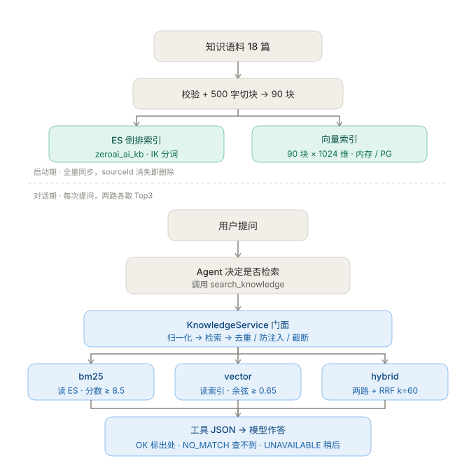
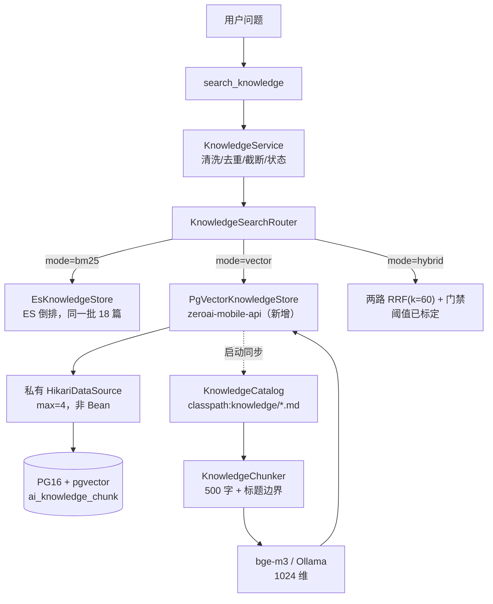

# PHASE-10：售后语料 · PGVector RAG（实施稿 v2）

> 状态：**已实施，端到端待环境验证**（2026-11-25）。
> 决策记录：`ADR-004-pgvector-after-sale-corpus.md`。
> 语料源：`docs/knowledge_source/after/`（15 篇爬取文档，61 张图片）。
> v1 的方案讨论已被本稿覆盖：语料从「新增独立域」改为「替换原售后口径」，因此取消了
> `corpus` 列、双域隔离与 `hybrid` 禁令。

---

## 1. 结论

| 项 | 结果 |
|---|---|
| 语料 | 14 篇产出去品牌版本（13 篇入库 + 1 篇人工整理），1 篇内部协同文档整篇删除；原 `kb-after-sale-refund.md` 删除 |
| 存储 | `zeroai-mobile-api` 新增 `PgVectorKnowledgeStore`，直连 JDBC，连接池私有 |
| 切换 | `zeroai.ai.knowledge.mode=vector` + `vector.store=pgvector`，默认仍是 `bm25` + `memory` |
| embedding | 本机 Ollama `bge-m3`，1024 维，`vector(1024)` 硬校验 |
| 已验证 | starter 269 测试通过；mobile-api 编译通过 |
| 未验证 | PGVector 真实同步/检索（Docker 与 Ollama 均未启动） |

---

## 2. 语料事实（规范化前后）

| 指标 | 原始 | 入库后 |
|---|---|---|
| 文档数 | 15（+README） | 13 篇新增，总计 18 篇（含原 5 篇通用规则） |
| 正文字符 | 38,804 | 33,112 |
| 图片引用 | 74 处 | 0 |
| 标题 | 106 | 保留结构，删除空壳叶子标题 |
| 表格行 | 168 | 转为「表头：值」列表；依赖平台账户体系的整表删除 |
| 切块（500 字） | — | 90 块（300 字实测 152 块） |

**删除整篇**：`咚咚服务单备注`（46 个平台专属词，全部是内部工作台与商家协同操作，无对外政策口径）。

---

## 3. 语料规范化

脚本：`scripts/agent/knowledge/normalize_aftersale_docs.py`（幂等，可重跑）。

### 3.1 规则

| 类别 | 处理 |
|---|---|
| 品牌 | 京东→本商城、京东自营→商城自营、直通车→删、咚咚→在线客服、供应商→商家、京东物流→商城配送 |
| 业务概念 | 「售后直通车」是**服务标识**而非平台名，单独替换为「售后快捷通道」（不能一起删） |
| 账户体系 | 京豆、白条、PLUS、京享值、京东金融、E卡、保险经纪、开放平台、京麦：出现即整块剔除 |
| 图片 | 整行删除；表格单元格里的图变空单元格；空壳叶子标题删除 |
| 表格 | 每行转 `- 表头：值；表头：值`；表头含「客户级别/会员等级」或平台账户体系时整表删除 |
| 链接 | 图片、Markdown 链接、裸 URL 全部删除（含 `help.jd.com`、`joyspace`、`360buyimg`） |
| 结构 | 去强调符号、统一项目符号、压缩空行、删除悬空冒号句与重复标题行 |

### 3.2 逐篇处理

| 新文件 | 原标题 | 处理 |
|---|---|---|
| `kb-aftersale-policy.md` | 售后政策介绍 | 字面替换；PLUS/京豆段落剔除 |
| `kb-aftersale-policy-consult.md` | 售后政策咨询 | 字面替换 |
| `kb-aftersale-request.md` | 售后问题申请 | 字面替换（供应商→商家） |
| `kb-aftersale-audit-urge.md` | 审核处理催促 | 字面替换；表格结构化 |
| `kb-aftersale-audit-dispute.md` | 审核结果不认可 | 字面替换 |
| `kb-aftersale-installation.md` | 家电家居安装 | 京东安装→商城安装；京东服务+→商城安装服务 |
| `kb-aftersale-short-refund.md` | 少退款处理思路 | **人工重写**：源文档编号断裂、京豆抵扣/保险赔付段落删除后不可读 |
| `kb-aftersale-restricted-goods.md` | 政策管控商品无法寄出 | 去时间点（「9月4日后」→「管控期结束后」） |
| `kb-aftersale-user-guide.md` | 用户售后功能介绍 | 入口路径去品牌；渠道枚举（厂直/一号店/pop）简化 |
| `kb-aftersale-return-shipping.md` | 返件方式及运费规则 | 字面替换；会员等级运费表整表删除 |
| `kb-aftersale-refund-timing.md` | 退款到账时效及路径 | 去白条/京东金融行；保留微信/支付宝/银行卡时效 |
| `kb-aftersale-free-pickup.md` | 免费上门退换权益介绍 | 去保险承保/PLUS/魔镜等级；余额返还→原支付账户 |
| `kb-order-cancel.md` | 取消订单相关 | 去京豆拒收规则表与白条；保留取消条件与部分退规则 |

### 3.3 质量闸门

```
grep -rn "京东|京豆|白条|PLUS|京享|咚咚|直通车|供应商|京麦|魔镜|http|本商城余额"  → 必须为空
空标题 / 空列表项 / 悬挂冒号                                               → 必须为空
KnowledgeCatalog 解析：rejected = 0，documents = 18
```

---

## 4. 架构

完整链路：上半区是启动期的索引构建，下半区是对话期的检索与作答。



下面的图只画**存储实现与装配接线**（`vector.store` 二选一、PG 连接池私有化）：



**装配互斥**：`vector.store` 二选一。两个 `VectorKnowledgePort` 同时存在会让路由在
`ObjectProvider.getIfAvailable()` 处直接抛 `NoUniqueBeanDefinitionException`。

---

## 5. 数据设计

建表脚本：`pgvector/init/01-schema.sql`（compose 挂载到 `/docker-entrypoint-initdb.d`）。

核心字段：

| 字段 | 用途 |
|---|---|
| `source_id` + `chunk_index` | 唯一键；文档更新整篇覆盖，变短时删尾部 |
| `content_hash` | sha256，增量同步只重算变化的块 |
| `embedding vector(1024)` | 必须等于 `embedding.dimension`，启动硬校验 |
| `embedding_model` | 换模型时识别旧向量，拒绝跨空间检索 |
| `visibility` | 默认 `public`；内部语料不会被公开链路检索到 |
| `section` / `content` | `content` 已带【标题 · 小节】前缀，直接给模型 |

**没有 `corpus` 列**：只有一套售后口径，多域隔离已无对象；将来真需要并存时再加列并配套过滤。

检索 SQL：

```sql
SELECT source_id, title, category, version, updated_at, content,
       1 - (embedding <=> ?::vector) AS score
FROM ai_knowledge_chunk
WHERE visibility = ?
  AND 1 - (embedding <=> ?::vector) >= ?
ORDER BY embedding <=> ?::vector
LIMIT ?;
```

---

## 6. 同步与失败语义

- 启动同步由 `knowledge.sync-on-startup` 控制；`mode=bm25` 时直接跳过，不产生 embedding 调用。
- 单篇失败只跳过该篇并记 ERROR；目录为空时**拒绝清空索引**（防止打包错误把知识库清空）。
- PG 不可用：同步失败不阻断启动；检索抛 `IllegalStateException`，门面转 `UNAVAILABLE`，
  模型说「检索暂不可用」而不是「没有这条政策」。
- 增量：哈希命中跳过向量化；`chunk_index >= 新块数` 删除尾部；收尾删除孤儿 `source_id`。

---

## 7. 配置

```yaml
zeroai.ai.knowledge:
  mode: hybrid                  # bm25 | vector | hybrid
  min-should-match: 2<100% 4<60%   # 短查询全中、长查询 60%，见第 9 节
  min-score: 8.5                # BM25 分数下限（8.0~9.0 平台取中点）
  vector:
    store: pgvector             # 关掉就回 memory
    chunk-size: 500
    min-chunk-chars: 120
    min-score: 0.65             # 余弦下限，唯一零误召回点
  hybrid:
    vector-only-min-score: 0.65 # BM25 零命中时向量单独作答的门槛
  pg:
    url: jdbc:postgresql://127.0.0.1:5432/zeroai_ai
    username: zeroai
    password: ${AI_KNOWLEDGE_PG_PASSWORD}   # 只从环境注入
    table: ai_knowledge_chunk
    pool-size: 4
    visibility: public
```

四个阈值都是 2026-11-25 在真实 ES + 真实 bge-m3 上标定的，互为配套而非独立：
BM25 的 8.5 是「只报高置信命中」，长尾召回由向量补位。**单独改其中任何一个都会破坏分工**，
改之前先读第 9 节。

---

## 8. 风险

| 编号 | 等级 | 问题 | 应对 | 验证 |
|---|---|---|---|---|
| P0-1 | 高 | 新增 DataSource Bean 顶替主数据源 | 连接池私有持有，不注册 Bean | 启动日志确认主库 URL 仍是 MySQL |
| P0-2 | 高 | 维度不一致，检索静默全错 | `format_type()` 硬校验 + 模型名落库 | 配 768 启动应明确失败 |
| P1-1 | 中 | 政策承诺超出系统能力（换货/维修/上门） | 提示词第 8 条：只解释不承诺 | 人工对话抽检 |
| P1-2 | 中 | 图片信息缺失（61 张，部分为规则截图） | 本期明确不解析；不用占位符伪造 | 抽 10 条仅存在于图片的问题，记录为已知缺口 |
| P1-3 | 中 | 去品牌导致语义失真 | 账户体系整块剔除而非改写；人工复核 13 篇 | 本次已逐篇抽查 |
| P1-4 | 中 | 增量同步残留旧块 | 尾部删除 + 孤儿清理 | 删一节后重跑，块数应下降 |
| P2-1 | 低 | 启动同步拖慢启动 | 开关 + 失败不阻断；批量 16 | 断网启动应仍能起来 |
| P3-1 | 建议 | 阈值沿用旧语料 | 30 条评测集扫描 0.45–0.70 | 见第 9 节 |

---

## 9. 评测

用例：`scripts/agent/knowledge/cases-aftersale.jsonl`（22 条可答 + 8 条库外陷阱）。

```bash
python3 scripts/agent/knowledge/eval_knowledge.py \
  --base http://127.0.0.1:82 \
  --cases scripts/agent/knowledge/cases-aftersale.jsonl \
  --limit 3 --out logs/kb-aftersale-eval.json
```

目标（假设值，首轮实测后固化）：hit@3 ≥ 85%、库外误召回 ≤ 15%、检索 p95 ≤ 800ms。

阈值标定：固定语料与用例，`vector.min-score` 从 0.45 到 0.70 每 0.05 一档，
取「hit@3 不低于峰值 3 个百分点、误召回最低」的一档，写回 `application.yml` 并附本轮数据。

### 9.1 首轮标定结果（2026-11-25，真实 bge-m3）

数据与复现见 [`evidence/2026-11-25-aftersale-threshold-calibration.md`](./evidence/2026-11-25-aftersale-threshold-calibration.md)。

| 项 | 结果 |
|---|---|
| 语料 / 用例 | 18 篇 / 90 块；30 条（22 可答 + 8 库外） |
| 可答 top1 | 0.605 / 中位 0.726 / 最高 0.799 |
| 库外 top1 | 中位 0.586 / 最高 **0.648** |
| 0.65 阈值 | 纯向量 hit@3 81.8%、库外误召回 **0/8** |
| 0.64 阈值 | hit@3 95.5%，但误召回「开发票」「货到付款」2/8 |
| 结论 | `vector.min-score=0.65` |

### 9.2 BM25 与 hybrid 标定（2026-11-25 第二轮，ES 启动后补做）

| 项 | 结果 |
|---|---|
| BM25 分数 | 可答 top1 中位 18.6、库外最高 12.4 |
| 原参数（`2<70%` + 1.5） | hit@3 90.9%，**库外误召回 3/8**（开发票/价保/指定快递） |
| `min-should-match` 结论 | **`2<100% 4<60%`**：训练 22/22 误 0、留出 8/10 误 0 |
| `min-score` 结论 | **8.5**：8.0~9.0 为零误召回平台区 |
| hybrid 训练集 | **hit@3 22/22、库外误召回 0/8** |
| hybrid 留出集（14 条新问法） | hit@3 8/10、库外误召回 0/4 |
| 端到端（应用 `mode=hybrid`） | 三条验证全通过，含「BM25 零命中、向量补位」场景 |

两路互补是实测事实：A02/A05/A16/A17 只有向量能命中，A04/A07/A09/A14 只有 BM25 能命中。
支撑数据与敏感性分析见 [标定记录](./evidence/2026-11-25-aftersale-threshold-calibration.md)。

**仍未覆盖**：PGVector 存储那一路的端到端（Docker/Postgres 未启动）。
本轮 hybrid 验证用的是 `vector.store=memory`，PG 与 memory 共用同一套向量分数与阈值，
但持久化链路的建表、增量同步、维度校验仍需按第 10 节实跑一遍。

---

## 10. 手工验证步骤（待环境恢复）

前置：Docker Desktop 启动；`docker compose -f docker-compose-es7-rabbitmq-redis-mysql.yml up -d pgvector`；
`ollama list` 能看到 `bge-m3`。

1. **建表**
   `psql "postgresql://zeroai:<pwd>@127.0.0.1:5432/zeroai_ai" -c "\d ai_knowledge_chunk"`
   应看到 `embedding | vector(1024)`。
   已有数据目录不会执行 init 脚本，需手工 `psql -f pgvector/init/01-schema.sql`。
2. **Ollama 连通**
   `curl -s http://127.0.0.1:11434/api/tags` 返回 JSON，且含 `bge-m3`。
3. **启动应用**（`.env` 设 `AI_KNOWLEDGE_MODE=vector`、`AI_KNOWLEDGE_VECTOR_STORE=pgvector`）
   日志应出现：`PGVector 表校验通过 table=ai_knowledge_chunk type=vector(1024) model=bge-m3`、
   `PGVector 同步完成 documents=18 chunks=90 written=90 skipped=0`。
4. **检索**
   `curl "http://127.0.0.1:82/ai/knowledge/search?q=退款多久到账"` 应命中
   `kb-aftersale-refund-timing`。
5. **增量**
   再启动一次，`written=0`（全部哈希命中）。
6. **降级**
   停掉 pgvector，检索返回 `UNAVAILABLE`，应用仍可启动。
7. **评测**
   跑第 9 节脚本，记录首轮基线并按结果调阈值。

---

## 11. 实施进度

| 项 | 状态 |
|---|---|
| 语料规范化 13 篇 + 删除旧售后文档 | 已完成，rejected=0 |
| `PgVectorProperties` / `PgVectorKnowledgeStore` | 已完成，编译通过 |
| `vector.store` 二选一装配 | 已完成 |
| 建表 SQL、compose healthcheck、驱动依赖 | 已完成 |
| application.yml / .env.example | 已完成 |
| 提示词能力边界 | 已完成 |
| 30 条评测用例 + 14 条留出用例 | 已完成 |
| 向量阈值标定（真实 bge-m3） | 已完成：`vector.min-score=0.65` |
| BM25 阈值标定（真实 ES + IK） | 已完成：`2<100% 4<60%` + `8.5` |
| hybrid 阈值与融合标定 | 已完成：训练 22/22、库外 0/8；留出 8/10、0/4 |
| 端到端对话验证（`mode=hybrid`） | 已完成：可答命中 / 库外拒答 / 向量补位 三条通过 |
| starter 测试 | 269 通过 / 0 失败 / 1 跳过 |
| PG 端到端 | **未执行**：Postgres 容器未启动（本轮验证用 `vector.store=memory`） |

---

## 12. 回滚

```yaml
zeroai.ai.knowledge.vector.store: memory
zeroai.ai.knowledge.mode: bm25
```

回到进程内索引 + ES 倒排；PG 容器可停，`ai_knowledge_chunk` 可 drop（向量是派生数据）。
注意：旧文档 `kb-after-sale-refund.md` 已删除，回滚代码不会恢复知识内容，
如需旧口径需同时回滚该文件。

---

## 13. 接触面

| 文件 | 变更 |
|---|---|
| `zeroai-mobile-api/.../service/ai/PgVectorKnowledgeStore.java` | 新增 |
| `zeroai-mobile-api/.../config/PgVectorProperties.java` | 新增 |
| `zeroai-mobile-api/pom.xml` | 新增 `org.postgresql:postgresql`（runtime） |
| `zeroai-ai-starter/.../knowledge/KnowledgeProperties.java` | 新增 `vector.store` |
| `zeroai-ai-starter/.../config/KnowledgeAutoConfiguration.java` | memory 实现加条件装配 |
| `zeroai-ai-starter/src/main/resources/knowledge/*.md` | 新增 13 篇、删除 1 篇 |
| `zeroai-ai-starter/src/main/resources/prompts/guide-system.st` | 新增售后边界两条 |
| `pgvector/init/01-schema.sql`、compose | 新增 |
| `scripts/agent/knowledge/normalize_aftersale_docs.py`、`cases-aftersale.jsonl` | 新增 |
| `zeroai-mobile-api/src/main/resources/application.yml`、`.env.example` | 新增配置 |

**未改动**：`KnowledgeService`、`KnowledgeSearchRouter`、`SearchKnowledgeTool`、
AgentScope / LangChain4j 引擎代码。
