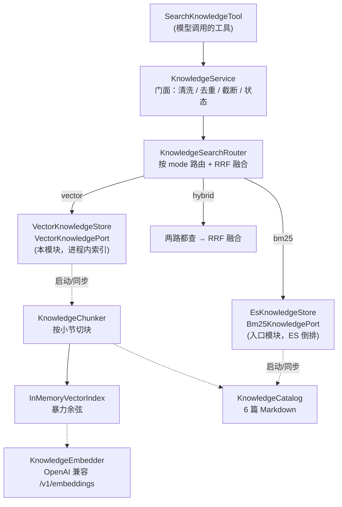

# 知识检索的模式切换：BM25 / 向量 / 混合

> 承接 [`PHASE-7-rag-knowledge.md`](./PHASE-7-rag-knowledge.md)。Phase 7 落地的是「复用 ES 的 BM25 检索」，
> 本篇补上被推迟的那一半：**向量检索的实现，以及三种模式的切换机制**。
>
> 范围上仍然守住三条边界：知识源不扩（还是那 6 篇）、不执行 P8、不新增必须常驻的中间件。

## 1. 这一篇要解决的问题

Phase 7 的结论是「BM25 在当前语料上够用」，但那是一个**基于 29 条评测用例的观察，不是架构结论**。
真正的风险在于：一旦发现「用户换个说法就问不出来」，代码里没有任何可以切换的余地——
`KnowledgeSearchPort` 只有一个实现，`mode` 这个概念根本不存在。

这一篇把「换检索方式」变成一次配置变更：

```yaml
zeroai.ai.knowledge.mode: bm25    # 默认；改成 vector 或 hybrid 即可切换
```

切换的代价被压到最低：不改代码、不改工具定义、不改提示词、不改前端。
`SearchKnowledgeTool`、`/ai/knowledge/search`、`KnowledgeService` 全程无感。

## 2. 为什么向量索引还是不用 PGVector

Phase 7 拒绝 PGVector 的理由是「多一个中间件、多一条失败链路，换不来可验证的收益」。
这次要加向量检索，这个理由**依然成立**，所以换了个更轻的做法：**进程内向量索引**。

| 方案 | 新增基础设施 | 建索引成本 | 适用规模 | 本项目是否采用 |
|---|---|---|---|---|
| PGVector 容器 | 一个 Postgres + 扩展 + 连接池 + 独立 compose profile | 入库一次 | 万级以上 | 否 |
| ES `dense_vector` | 无（复用 ES） | 入库一次，改 mapping 要重建索引 | 万级以上 | 否 |
| **进程内暴力余弦** | **无** | **启动时 11 次物化（本机 < 1s）** | **百级块** | **是** |

判断依据是实测规模：6 篇政策文档切块后是 **11 个块**。对 11 个 1024 维向量做暴力余弦，
是微秒级操作，比一次 HTTP 往返还快两个数量级。在这个规模上引入 ANN 索引，
等于为 11 条数据建一个数据库。

真到需要持久化或上量的那天，替换点只有一个：`VectorKnowledgeStore` 内部的 `InMemoryVectorIndex`。
`KnowledgeSearchPort`、路由、门面、工具全都不动。

## 3. 结构



两个实现用 `Bm25KnowledgePort` / `VectorKnowledgePort` 两个**标记接口**区分，
而不是靠 bean 名字或注解反射。原因很实际：如果路由直接注入 `List<KnowledgeSearchPort>`，
这个列表会包含路由自己，构造器循环依赖；标记接口让「谁是 BM25」变成编译期事实。

## 4. 三个关键设计决定

### 4.1 向量检索必须先分块，切法不能定长

一篇同时讲「退款条件」「退款到账时间」「退款金额计算」的文档，整篇算一个向量时，
这个向量表示的是「这篇文档大概讲售后」——而用户问的是其中一个细节。
切成三块之后，每块向量对准一件事。

但切法很关键。**不用定长滑窗**：窗口会把「退款到账时间为 1-3 个工作日」切成
「退款到账时间为 1-3」和「个工作日」，两块都失真。政策文档本身按小节组织，
小节边界就是天然的语义边界：

```
## 退款到账                        ← 小节边界，开新块
审核通过后原路退回，银行卡 1-3 个工作日到账。
                            ← 空行只是段落边界，不立即断块（短段落要合并，信息密度更高）
超过块长度才退化：按「。；！？」切句，绝不切在句中
```

块文本前会拼上「【退款与售后政策 · 退款到账】」前缀。这是为了短问句：
「多久到账」只有四个字，没有上下文时向量很容易漂；带上标题后它落在正确的语义区域。

实测：6 篇文档 → **11 块**（平均 1.8 块/篇）。偏少，说明这些文档本身就不长
（多数在 300~500 字）。真正需要分块收益的是那种单篇几千字的长政策。

### 4.2 三种分数不能共用一个阈值

这是这次改动里最容易埋雷的地方。三种检索的分数量纲完全不同：

| 检索 | 分数含义 | 本项目实测区间 |
|---|---|---|
| BM25 | 无上界的相关度，随文档长度与词频漂移 | 正确命中 2.4+，噪声 1.7- |
| 向量 | 余弦相似度，固定 0..1 | 相关 0.6~0.85，无关 0.2~0.4 |
| RRF 融合 | `Σ 1/(k+rank)` | 0.016（单路第 1）~ 0.033（两路第 1） |

如果沿用 Phase 7 的做法——门面按 `min-score: 1.5` 统一过滤——切到向量模式后
**所有结果都会被滤掉**，而且不报错，表现为「政策全部查不到」。
这类故障最难排查：日志干净、接口 200、就是没有内容。

所以阈值被下沉到各实现：

```java
// KnowledgeService.tidy() 不再判断分数
if (!seenSource.add(hit.sourceId())) continue;   // 只做去重
```

- `zeroai.ai.knowledge.min-score`（1.5）→ 只给 ES 用
- `zeroai.ai.knowledge.vector.min-score`（0.55）→ 只给向量用
- `zeroai.ai.knowledge.hybrid.min-score`（0）→ 一般不开

门面的职责收敛到「片段能不能安全地给模型看」：注入清洗、按 sourceId 去重、按句截断。

### 4.3 查询串的清洗强度要跟检索方式走

Phase 7 在门面里剔除疑问词（「在哪里」「怎么」「可以」），因为 ik 会把它们切成词元、
计入 `minimum_should_match` 的分母，把正常问法压到阈值以下。

但**向量检索恰恰需要这些词**。「在哪里查看退款进度」去掉「在哪里」之后语义变弱了。
同一句问话，字面检索需要洗、语义检索不需要洗——这个事实必须在代码里有落点：

```java
KnowledgeQueryNormalizer.clean(raw, max)       // 只清理字符，不动语义 → 向量用
KnowledgeQueryNormalizer.stripNoise(raw, max)  // 再剔疑问词        → ES 用
```

门面只调 `clean`，`EsKnowledgeStore` 自己调 `stripNoise`。
这样混合模式下两路拿到的是各自最合适的查询串，而不是一个折中的四不像。

## 5. 混合模式：为什么是 RRF，不是加权分数

```java
// 第 r 名贡献 1/(k+r)，同一 sourceId 两路相加
score(doc) = Σ 1/(rrfK + rank_i)
```

不用「0.3 × bm25 + 0.7 × cosine」的理由很简单：这两个分数没有可比性，
任何权重都是拍脑袋，换语料就得重调，而且调错了看不出来。
RRF 只用**排名**：两路都排第一的文档，一定优于只在一路排第一的。这个判断不依赖量纲。

两个参数：

- `rrf-k = 60`：业界常用默认。k 越大，靠后的名次被拉平得越厉害。
- `hybrid.min-score = 0`：**默认不过滤**。曾经设成 0.02（想只保留「两路都认可」的），
  问题是单路第一名的分数是 1/61 ≈ 0.0164，会被直接滤掉——而「只有向量命中、
  BM25 完全没命中」恰恰是引入向量的理由，滤掉它等于白做。两路各自的阈值已经做过相关性过滤，
  这里再设阈值属于重复惩罚。

## 6. 失败语义：三种模式 × 三种故障

这是本次实机验证的重点。**能力故障和知识缺失必须说成不同的话**：

| 场景 | 行为 | 模型会怎么说 |
|---|---|---|
| `bm25` + ES 挂了 | `UNAVAILABLE` | 「检索暂不可用，稍后再试」 |
| `bm25` + 有结果 | `OK` | 带引用回答 |
| `vector` + embedding 未配置 | `UNAVAILABLE` | 「检索暂不可用」 |
| `vector` + embedding 服务挂了 | `UNAVAILABLE` | 「检索暂不可用」 |
| `vector` + 索引没建起来 | `UNAVAILABLE` | 「检索暂不可用」 |
| `vector` + 正常但无匹配 | `NO_MATCH` | 「这条我查不到」 |
| `hybrid` + 向量挂了 + `fallback=true`（默认） | 退回 BM25，WARN | 正常回答，质量退化 |
| `hybrid` + 向量挂了 + `fallback=false` | `UNAVAILABLE` | 「检索暂不可用」 |
| `hybrid` + 两路都挂 | `UNAVAILABLE` | 「检索暂不可用」 |

关键点：`VectorKnowledgeStore.search()` 在索引未就绪时**抛异常**，不返回空列表。
返回空列表会被门面解释成 `NO_MATCH`，模型就会告诉用户「知识库里没有这条政策」——
而事实是系统没准备好。把故障伪装成知识缺失，比报错危险得多。

同理，`OpenAiEmbeddingClient` 对任何失败都抛异常，绝不返回零向量：
零向量与一切文本的余弦都是 0，会被当成「没有相关内容」，又是一次静默伪装。

## 7. 配置与切换

```yaml
zeroai.ai.knowledge:
  mode: bm25                  # bm25 | vector | hybrid

  # 向量化（OpenAI 兼容 /v1/embeddings）
  embedding:
    base-url: ""              # 空 = 不装配，向量分支自动不可用
    path: /v1/embeddings
    api-key: ""
    model: text-embedding-v3
    dimension: 1024           # 校验值，不是旋钮：与模型实际返回不符会启动即失败
    timeout-ms: 5000
    max-chars: 1000
    batch-size: 16

  vector:
    min-score: 0.55           # 余弦下限，与 bm25 的 min-score 量纲不同
    chunk-size: 300
    min-chunk-chars: 60
    prefix-title: true

  hybrid:
    rrf-k: 60
    min-score: 0
    fallback-to-bm25: true
```

切换步骤：

1. 配 `embedding.base-url` / `model` / `dimension`（三家常见取值见 `.env.example` 注释）
2. 把 `mode` 改成 `vector` 或 `hybrid`
3. 重启。启动日志会打印实际装配情况：

```
知识检索路由已装配 mode=hybrid bm25=ready vector=ready
启用向量化 model=fake-hash-256 dimension=256 baseUrl=http://127.0.0.1:18080
向量索引构建完成 documents=6 chunks=11 rejected=0 model=fake-hash-256
```

**维度必须填对**。这是刻意的硬校验：1024 维的索引配 768 维的查询，
不会报错，只会算出一堆噪声相似度，最终表现为「政策全部查不到」。
启动时失败一次，比在线上排查三天便宜。

## 8. 验证

### 8.1 单元测试

AI starter **183 个用例全绿**（Phase 7 是 125，本次新增 58）：

| 测试类 | 用例 | 覆盖什么 |
|---|---|---|
| `KnowledgeModeTest` | 5 | 解析、未知值回落 BM25、哪些模式需要 embedding |
| `KnowledgeQueryNormalizerTest` | 6 | `clean` 不改语义 / `stripNoise` 剔虚词但保业务词 / 全剔空回退 |
| `KnowledgeChunkerTest` | 7 | 按小节切、段落合并、长段落按句切、短尾块吸收、前缀 |
| `InMemoryVectorIndexTest` | 7 | 排序、同文档只留一块、阈值过滤、维度不符跳过、重建失败保留旧索引 |
| `VectorKnowledgeStoreTest` | 9 | 真实 6 篇知识库建索引、未就绪抛不可用、bm25 模式不建索引、启动失败不阻断 |
| `KnowledgeSearchRouterTest` | 12 | 三种路由、RRF 排序与去重、向量挂了回退、两路挂抛异常 |
| `OpenAiEmbeddingClientTest` | 12 | data[] 乱序重排、维度不符报错、非 2xx、无密钥不发 Authorization、批量拆批 |

`OpenAiEmbeddingClientTest` 用 JDK 自带的 `HttpServer` 起本地假服务，
不打外网、不 mock HTTP 库——测的是真实的请求构造与响应解析。

全链路 `mvn -o -pl zeroai-mobile-api -am test` **BUILD SUCCESS**。

### 8.2 实机验证

因为 DeepSeek 不提供 embedding 接口、本机也没跑 Ollama，验证用一个
**假 embedding 服务**（`scripts/agent/knowledge/fake_embedding_server.py`，
字符 uni/bi-gram + feature hashing，256 维）。它**没有语义能力**，
只能证明链路通、降级对，不能评估召回质量——这一点必须说清楚。

| # | 配置 | 启动日志 | 检索结果 |
|---|---|---|---|
| 1 | 默认（bm25，不配 embedding） | `mode=bm25 bm25=ready vector=ready` | 3 条查询与 Phase 7 完全一致 |
| 2 | `hybrid` + 假服务在 | `chunks=11 dimension=256` | 退款→退款政策、运费→运费规则、优惠券→优惠券规则；开发票 `NO_MATCH` |
| 3 | `hybrid` + 假服务停 | `ERROR 向量索引构建失败…ConnectException`，启动不阻断 | 仍 `OK`，命中正确——**自动退回 BM25 生效** |
| 4 | `vector` + 假服务在，阈值 0.35 | `mode=vector vector=ready` | 退款命中；运费 `NO_MATCH` |
| 5 | `vector` + 阈值 0.1 | — | 运费、优惠券**都排第一**（排序是对的），但「开发票」被硬凑到优惠券 |
| 6 | `vector` + 假服务停 | 同上 ERROR | `UNAVAILABLE`，**不是** `NO_MATCH` |

第 3 条和第 6 条是这次最想验证的两件事：

- 向量分支挂掉时，混合模式**没有整体失效**，而是退回 BM25 继续回答（日志 WARN 说明退化了）
- 纯向量模式下服务挂掉时，接口返回 `UNAVAILABLE` 而不是「查不到」——
  用户会被告知「稍后再试」，而不是被误导成「商城没有这条政策」

第 4、5 条对照说明了阈值不能拍脑袋：同一批查询，阈值 0.35 时「运费」查不到，
降到 0.1 时正确命中，但「开发票」（知识库里根本没有）也开始被硬凑。
**阈值必须在真模型 + 评测集上校准，不能在假向量上定。**

## 9. 局限（明确没做的事）

1. **语义效果未实测**。没有可用的真实 embedding 服务（DeepSeek 无此接口、本机无 Ollama），
   所以「向量检索到底能不能救回 BM25 漏掉的问法」这个问题，本篇没有答案。
   链路、降级、状态语义都验证了，召回质量没有。
2. **0.55 这个阈值只有通用经验支撑**（中文 embedding 的相关/无关分布），
   换模型必须重校准。Phase 7 的 1.5 是在 29 条用例上实测出来的，向量这边还没有。
3. **索引不持久化**。每次启动重算，11 次物化在本机不到 1 秒；语料上千条时
   应换成持久化实现，否则启动预算会被吃掉。
4. **分块无 overlap**。跨块的规则（前半句在一块、后半句在下一块）可能召回不全。
   加 overlap 会让索引翻倍，在 11 块的规模上先不加。
5. **混合模式每次问答多一次 embedding 调用**，延迟增加约一个网络往返，成本也增加。
   默认仍是 bm25，正是因为这个代价不该默认付出。
6. **假 embedding 服务只用于联调**。它的向量没有语义，任何基于它的召回质量结论都是错的。

## 10. 验收对照

| 要求 | 实现 | 证据 |
|---|---|---|
| 新增向量 RAG 检索代码逻辑 | `KnowledgeChunker` + `InMemoryVectorIndex` + `VectorKnowledgeStore` + `OpenAiEmbeddingClient` | `VectorKnowledgeStoreTest` 9 例、实机 #2 |
| 可以切换 ES 与向量检索 | `zeroai.ai.knowledge.mode` = bm25 / vector / hybrid，`KnowledgeSearchRouter` 路由 | 实机 #1/#2/#4 三次切换 |
| 切换不影响上层 | 工具、HTTP 接口、提示词、前端零改动 | `SearchKnowledgeToolTest` 全绿 |
| 不引入必须常驻的中间件 | 进程内索引，PGVector 仍注释在 `.env.example` | 无新增容器 |
| 故障不能被伪装成「没有知识」 | 索引未就绪/向量化失败一律抛异常 → `UNAVAILABLE` | 实机 #6 |
| 混合模式单路故障可继续服务 | `hybrid.fallback-to-bm25`（默认开） | 实机 #3 |
| 知识源不扩 | 仍是 6 篇，`VectorKnowledgeStoreTest` 断言 `documents=6` | 测试锁定 |
| 不执行 P8 | 未触碰 | — |

## 11. 代码清单

**新增（`zeroai-ai-starter`）**

| 文件 | 职责 |
|---|---|
| `knowledge/KnowledgeMode.java` | 模式枚举，未知值回落 BM25 |
| `knowledge/KnowledgeEmbedder.java` | 向量化端口 |
| `knowledge/KnowledgeEmbeddingException.java` | 向量化失败（区别于检索逻辑错误） |
| `knowledge/OpenAiEmbeddingClient.java` | OpenAI 兼容客户端（JDK HttpClient + Jackson） |
| `knowledge/KnowledgeChunker.java` | 按小节切块，长段落按句切 |
| `knowledge/InMemoryVectorIndex.java` | 进程内索引，归一化后点积即余弦 |
| `knowledge/VectorKnowledgeStore.java` | 向量实现 + 启动构建 |
| `knowledge/KnowledgeSearchRouter.java` | 模式路由 + RRF 融合 + 降级 |
| `knowledge/KnowledgeQueryNormalizer.java` | `clean` / `stripNoise` 两级归一化 |
| `knowledge/Bm25KnowledgePort.java` | BM25 实现标记接口 |
| `knowledge/VectorKnowledgePort.java` | 向量实现标记接口 |
| `config/EmbeddingEnabledCondition.java` | 装配条件（mode 需要 + base-url 非空） |

**修改**

| 文件 | 改动 |
|---|---|
| `KnowledgeProperties` | 新增 `mode` 与 `embedding` / `vector` / `hybrid` 三组配置 |
| `KnowledgeService` | 移除分数阈值判断（下沉到实现），查询归一化降为 `clean` |
| `KnowledgeSearchPort` | 加 `mode()` 默认方法，仅供日志与排障 |
| `KnowledgeAutoConfiguration` | 装配 embedder、向量实现、`@Primary` 路由 |
| `EsKnowledgeStore`（mobile-api） | 实现 `Bm25KnowledgePort`；检索前调用 `stripNoise` |
| `application.yml` / `.env.example` | 模式与向量化配置 |
| `KnowledgeServiceTest` | 两处断言改为「门面不改语义、不按分数过滤」 |

**测试替身**

| 文件 | 用途 |
|---|---|
| `scripts/agent/knowledge/fake_embedding_server.py` | 本地假 embedding 服务，仅验证链路 |
